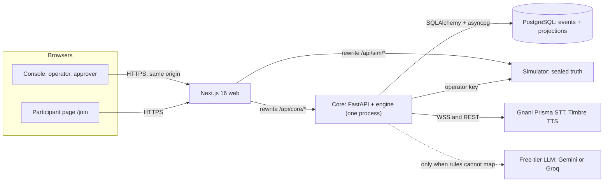
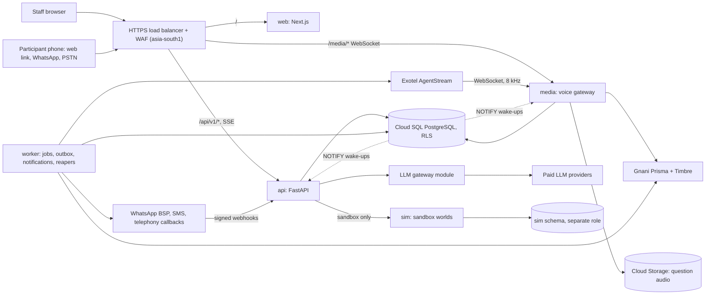
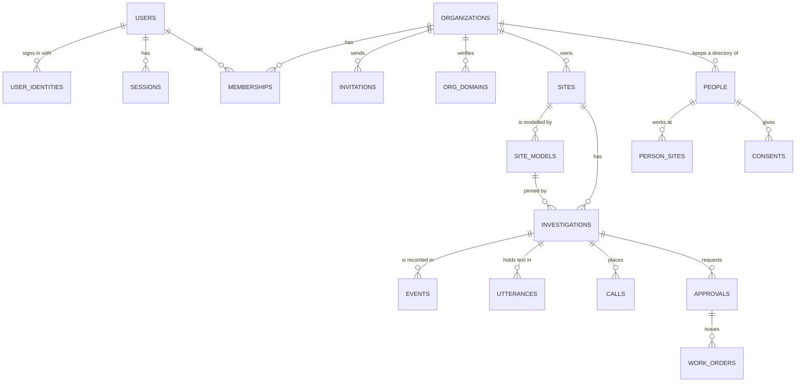
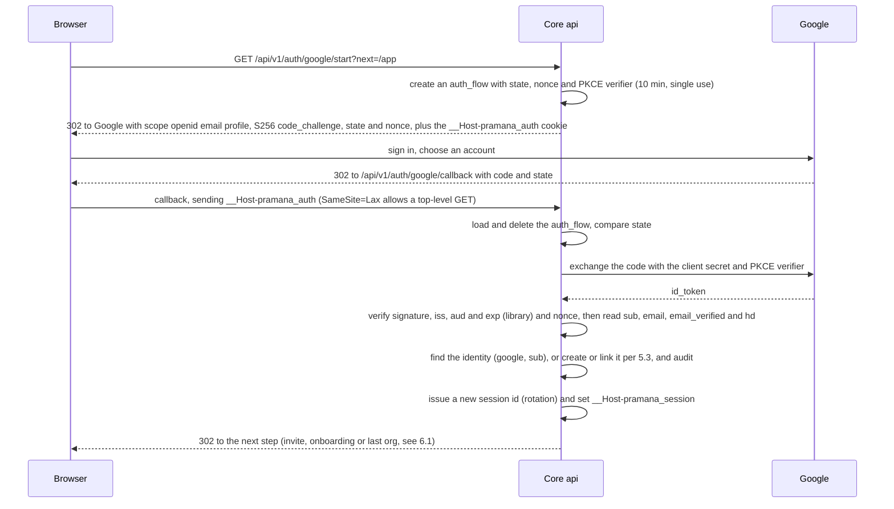
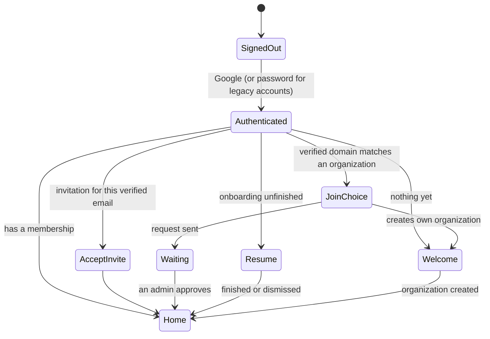

# PRODUCTION.md: taking Pramana from a hackathon build to a production system

| | |
|---|---|
| Written | 2026-11-07 (system date), against `main` at `e8194cb`. Release candidate `v1.0-rc1` is `8b24d0d`. |
| Status | Production implementation started on the isolated `production` branch with the user's approval on 2026-11-07. R0 code and infrastructure definitions are committed; no cloud resources have been applied. Submission scope and `main` remain frozen. See the dated production status report for implementation and verification evidence. |
| Goal | Turn one simulated building served by one process into a multi-tenant product that campuses, hospitals, offices and hotels in India can sign up for, model their own buildings in, and run with real people, real calls and real repairs. |
| Read with | `README.md`, `docs/PRODUCT.md`, `docs/PLAN.md`, `docs/engineering/ARCHITECTURE_REVIEW.md`, ADRs 0001 to 0014 |

**Evidence labels** (the PRODUCT.md set, plus [S] and [R]):

- **[V]** verified against a primary source on 2026-11-07 (the page was read, in full or in large part).
- **[C]** a company's own claim about its product or systems (engineering blogs, product docs).
- **[S]** a secondary source or a search summary of a primary source that was not read in full. Treat it as a lead, not a fact.
- **[I]** our inference.
- **[H]** a hypothesis to test.
- **[T]** a target, not a result.
- **[R]** our recommendation.

No number in this document is a measured Pramana result unless it cites a generated report. Prices and limits quoted from providers are list figures on the access date and will change.

---

## Any-site product conversion, 2026-11-08

The user asked that Pramana work for any kind of site and situation, keeping the vision
(PRODUCT.md §0-1: an active-sensing system whose sensors are people, for places sensors do not
cover), with real onboarding, saved state for returning users, every control backed by the
core, and every sidebar tab worth opening. This section is the plan of record for that work.

**What was wrong.** The engine was general, but the site model was not: `physics.py` knew only
building power and Wi-Fi, probe and component kinds were fixed enums, roles were five hostel
roles, and the only way to describe a site was hand-written YAML. The console was the
single-tenant hackathon console: it used the unscoped API, defaulted to `campus_block_c` in four
pages, kept preferences only in browser storage and had no onboarding route, although the core
already had `/v1/me`, onboarding state, organizations, sites and stored models.

**How comparable products structure this** (accessed 2026-11-08, [S] search summaries):

| Product | Structure | Take for Pramana |
|---|---|---|
| MaintainX, Fiix (maintenance software) | Asset register with a parent column; CSV import; people and locations created before assets | Describe a site as places, roles and equipment; import later |
| ServiceNow CMDB | One core relationship, "Depends on / Used by", along which impact propagates | The dependency physics' `requires` graph, with `any_of` for redundancy |
| ISO 14224 | Equipment classes, each with standard failure modes (fails to start, spurious stop, leakage) | An equipment library: pick a type, inherit its failure modes, checks and repairs |
| incident.io Catalog | Custom types with typed attributes and relationships, plus importers | Site descriptions are typed data validated with readable errors |

**Built (tested locally; see the status report).**

1. Dependency physics (`pramana_domain/rules.py`, `physics.py`): any system as components with
   `requires`, local faults and declarative probe rules. Network packs are unchanged; no
   `MODEL_VERSION` change.
2. Role catalogues per site. `Role` in the contracts is an identifier checked against the pinned
   model (`UNKNOWN_ROLE`).
3. Equipment library (`library.py`) and site builder (`builder.py`): places, roles, equipment and
   service points become a validated model with questions in every language, one decision per
   fault, checks restricted by skill and access, and generated walks.
4. Model health check (`pramana_eval/health.py`): faults nobody can notice, look-alike faults
   needing different decisions, unreachable checks, missing repairers, weak verification and
   decisions spanning several repair targets, plus simulated noisy investigations per fault.
5. A hand-written water-supply template and generated retail and hospital-ward sites, all
   diagnosed by the unchanged engine. The health check found that `campus_block_c`'s
   `DISPATCH_ELECTRICIAN_DB_C2` spans two breakers; it is left as is to keep replayed beliefs.

**Next slices, in order.**

| Slice | Scope | Exit |
|---|---|---|
| B. Site builder API | Org-scoped drafts: create from a template or description, validate, health check, publish an immutable version; equipment library and templates endpoints | Draft to published model over HTTP, tenant-leak tests, health report stored with the version |
| C. People per site | Directory under `/v1/orgs/{org}/sites/{site}/people`, roles checked against the published model | Old `/v1/participants` removed from production mode |
| D. Console foundation | `/app/[org]/...`, routing from `/v1/me`, server-side preferences, organization switcher, every page on scoped APIs, no `campus_block_c` in product code | Authenticity audit extended; a returning user lands where they left off |
| E. Onboarding | §7 flow: three questions, workspace, guided sandbox, "your site" from a template or description with the health check, people, test call | Browser tests per user state (new, invited, returning, removed) |
| F. Tabs | Overview: adaptive home with reasons. Investigations: live board. People: reliability learned per person. Sites: builder, health report, diff and publish. Evaluation: model health per site instead of global developer reports. Voice: device and language check. Settings: organization, team and invitations | Each tab backed by a core endpoint and its tests |

---

## Review notes, 2026-11-07

Checked on 2026-11-07 (evening, IST) against `main` at `e8194cb`, on the `production` branch.

**Implementation decisions confirmed by the user.** Start now on the branch only; use GCP
`asia-south1`; the name is Pramana and the domain is undecided. Ask for credentials by name only
when needed and have the user place values in the production worktree's untracked `.env`.

**Tenancy implementation review.** The expand migration also isolates organization metadata,
limits cross-organization membership visibility to reads, and uses composite site/model foreign
keys to refuse cross-tenant references. Published and retired models cannot return to draft,
change their spec or identity, or be deleted. The tenant-leak route generator and stored sandbox
provisioning are still pending the organization API slices; schema tests alone do not establish
application-level tenant isolation.

**Account and retry implementation, 2026-11-08.** Google sign-in is CI green on `87e05bd`,
[run 42387269258](https://github.com/darved2305/Pramana-AI-ggw_gnani-hackathon-/actions/runs/42387269258).
Real Google sign-in passed with the user locally on Nov 8. Organization creation needs
a user-scoped idempotency key before an organization exists, so the schema below now uses
`scope, principal, key` with a nullable organization. Responses are stored as bytes with selected
headers, and a short pending lease plus a row lock protects concurrent requests. Business state
and the serialized response join one database transaction. The 72-hour reaper is scoped and has
a maintenance command; scheduling it remains worker deployment work. Survey state has an
optimistic version and strong ETags. Published sandbox models are copied from a frozen database
template. Full organization-scoped API isolation remains Slice 4 work.

**Deployment budget decision, 2026-11-08.** The user confirmed that the complete application must
be deployed and set an INR 1,000/month total GCP budget. They approved Supabase Free PostgreSQL
in specific Mumbai (`ap-south-1`) with the app on GCP Mumbai (`asia-south1`), accepting free-tier
pausing and our own backups. No domain is owned; start with the managed Cloud Run HTTPS URL.
The HA Cloud SQL/load-balancer defaults in `infra/gcp` are now an unapproved larger-tier reference,
not this launch plan. See [the primary-source budget review](engineering/CLOUD_BUDGET_REVIEW_2026-11-08.md).
Project access and billing linkage were checked read-only. No cloud resource or API was created
or enabled, and STOP 2 remains before cloud apply. Private database schema/roles, durable sandbox
state, service invocation, quotas, backup/restore and spending controls must be verified first.

**Code claims (§1.4).** Every `file:line` cited in §1.4 still matches the tree: `api/directory.py:42,50,57,64`, `main.py:169`, `app/app/page.tsx:24-25`, `lib/api/core.ts:165`, `lib/store/local.ts:77`, `pack.py:344`, `speakable.py:10`, `investigations.py:132,362-366,791,883`, `auth/service.py:53,95`, `voice/governor.py:15`, `voice/media.py:117`, `auth/deps.py:60-67`, `login/page.tsx:204`, `lib/api/auth.ts:55-57`. The inventory holds: 29 HTTP paths, 7 migrations, 9 tables, an engine LRU of 32 (`ENGINE_CACHE_MAX`). No corrections were needed.

**Research claims re-checked (primary sources, accessed 2026-11-07).**

| Claim | Result | Change made |
|---|---|---|
| Google OIDC rules (§2.11, §5.2) | Confirmed [V]: validate the signature, `iss` (`accounts.google.com` or `https://accounts.google.com`), `aud` and `exp`; key users by `sub`; the email is authoritative only for `@gmail.com`, or with `email_verified` and `hd`; the `hd` request parameter is a UI hint, so check the claim; tokeninfo is not for production. Google's parameter table lists `nonce` as required, and the library verifiers do **not** check `nonce` or `hd`, so we check both ourselves. The discovery document lists `code_challenge_methods_supported: ["plain", "S256"]` [V] | §5.2 note added |
| Cloud Run WebSockets and billing (§2.8) | Confirmed [V]: request timeout 5 minutes by default, 60 at most; affinity is best effort; up to 1,000 concurrent connections per instance; an open WebSocket makes the instance active and billed as instance-based. Correction: minimum instances are not strictly required for background work, but an idle instance stops within 15 minutes without one; instance-based billing needs at least 512 MiB of memory | §2.8 row updated |
| IETF idempotency draft (§2.2) | Now **draft 08**, 22 Oct 2026, expires 25 Apr 2027, an active working-group draft [V]. The 400, 409 and 422 rules are unchanged (section 2.7) | §2.2 row updated |
| Sarvam onboarding (§2.12) | Confirmed [C]: an organisation and default workspace at sign-up; Owner and Member plus Admin, Editor and Viewer; only owners invite; the last owner cannot be removed or demoted. Free credits are **₹100** for verified users and never expire; the ₹1,000 figure was not found in the docs | §2.12 row updated |
| DPDP dates (§2.14) | Rules notified 13 Nov 2025; consent managers from **13 Nov 2026**; most obligations from **13 May 2027**; a 72-hour breach report [S: one law-firm note; MeitY's site returned 403]. Counsel and the Gazette text must still confirm | §2.14 row updated |

**Consistency (§4.3, §6.2, §15), and what the plan missed.**

1. **RLS cannot be tested with today's local role.** `scripts/dev_db.py` runs `initdb -U pramana`, so `pramana` is a superuser, and superusers bypass RLS even with `FORCE ROW LEVEL SECURITY`. R1 creates a non-superuser `pramana_app` role in the production databases and runs the app and tests as that role; `pramana` runs migrations only (§4.4).
2. **Tables named in the text but missing from §4.3:** `join_requests` (ID-03), `participant_links` (§5.6), `api_keys` (§5.5), `rate_limits` (§3.9), `media_leases` (§3.4), `llm_cache` (§3.7), and `jobs` if an owned queue is chosen (§3.8). Listed under §4.3; each is designed in the slice that first needs it.
3. **Checklist dismissal** (§7.11) had no column. It lives in `user_preferences.home_layout` with the pins and hides.
4. **R1 exit criteria versus the matrix.** DA-02 (draft model banner), DA-03 and DA-04 (people and consent) and DA-08 (pinned versions) depend on R2 features, so they move to R2's exit. OR-07 (deletion with an export) needs the export job, so it moves to R3. ID-08 needs a one-time email link; the slice 5 email interface with a local outbox file is enough to test it. ID-15's shared limiter can live in PostgreSQL in R1.
5. **Event idempotency scope** (§3.6 item 5, unique per investigation) was in no release. It joins R1 with the idempotency middleware.

---

## Contents

0. [One-screen summary](#0-one-screen-summary)
1. [How Pramana works today](#1-how-pramana-works-today)
2. [Research: what strong production systems do](#2-research-what-strong-production-systems-do)
3. [Target architecture](#3-target-architecture)
4. [Data model and saving](#4-data-model-and-saving)
5. [Identity: Google sign-in, sessions and roles](#5-identity-google-sign-in-sessions-and-roles)
6. [New users and returning users: routing and edge cases](#6-new-users-and-returning-users-routing-and-edge-cases)
7. [Onboarding](#7-onboarding)
8. [Site models as data](#8-site-models-as-data)
9. [Reaching real people: messages, calls and work orders](#9-reaching-real-people-messages-calls-and-work-orders)
10. [AI and voice in production](#10-ai-and-voice-in-production)
11. [Frontend](#11-frontend)
12. [Testing strategy](#12-testing-strategy)
13. [Deployment and operations](#13-deployment-and-operations)
14. [Security, privacy and compliance checklist](#14-security-privacy-and-compliance-checklist)
15. [Roadmap](#15-roadmap)
16. [Decisions to record as ADRs](#16-decisions-to-record-as-adrs)
17. [What we need from you: accounts and keys](#17-what-we-need-from-you-accounts-and-keys)
18. [Open questions and risks](#18-open-questions-and-risks)
19. [Sources](#19-sources)

---

## 0. One-screen summary

**Today.** Pramana is a deterministic Bayesian investigator for building faults that have no sensors. It asks consenting people what they can see, by voice (Gnani Prisma and Timbre) or text, in English, Hindi, Marathi and Hinglish. Language models only translate, and an approver must approve every repair. The engine, the event-sourced core, sign-in, approvals, verification, replay and live voice are real and tested: 3,453 Python tests, 35 UI and 19 real-stack browser tests passed on `f7a490b` (`eval/reports/verification-2026-11-07/report.md`). Later gate runs reached 48 UI and 21 real-stack tests (STATUS_2026-11-07.md item 43). Everything else is a demo: one YAML building, a simulator standing in for the world, synthetic people, accounts created from the command line, no organizations, and one process on a laptop.

**What production means here.** Many organizations, each with its own buildings, people and data. Each building is modelled through the product, not a YAML file. Staff sign in with Google. Real phones get WhatsApp, SMS and voice calls. The system survives restarts, retries, several instances and provider outages. Personal data is handled the way India's DPDP Act requires. It runs in an India region with logs, backups and on-call.

**Twelve decisions [R]**

| # | Decision | Why | Section |
|---|---|---|---|
| 1 | Stay a modular monolith, deployed as five processes from one codebase: `web`, `api`, `media`, `worker`, `sim` | Shopify, Segment and Prime Video lessons. Pramana's load is small, but its parts have different latency and scaling profiles | §3.2 |
| 2 | PostgreSQL remains the system of record, and the first tool for jobs, idempotency, leases and cross-instance wake-ups | It is already the source of truth (ADR 0003). Add Redis or a broker only on a measured trigger | §3.11 |
| 3 | Tenancy by `org_id` on every row, with PostgreSQL row-level security as a second lock | AWS "pool" model. RLS fails closed when the tenant is missing | §4 |
| 4 | Google sign-in implemented in the core (OIDC authorization code with PKCE, `state` and `nonce`). Sessions stay server-side | ADR 0010's session model is already right, and one session authority serves HTTP, SSE and WebSockets | §5 |
| 5 | Identities keyed by Google `sub`, never by email. Accounts are never merged silently | Google's guidance and the account pre-hijacking research | §5.3 |
| 6 | Every mutating request carries an `Idempotency-Key`. Webhooks are deduplicated through an inbox table, and side effects leave through an outbox | Stripe, AWS and the IETF draft | §3.6 |
| 7 | Site models become versioned data (draft, validate, simulate, publish), and investigations pin a version | Today one YAML file is the only site, and roles and languages are fixed enums | §8 |
| 8 | The simulator becomes each organization's **Sandbox**: the onboarding "aha" and a safe training ground. Live mode never uses it | Stripe sandboxes, the "talk to it in the browser" pattern of Vapi and Retell, and Pramana's own demo | §7.6 |
| 9 | Onboarding: one-click Google sign-in, three questions that change what comes next, an automatically created organization and sandbox, a two-minute guided investigation, then build your own site | Sarvam, Notion, Linear, Duolingo, NN/g | §7 |
| 10 | Personal data lives outside the event log. Events carry person ids, and erasure works by deleting a per-person key (crypto-shredding) | DPDP obligations from May 2027, and replay never needs names | §4.6 |
| 11 | Reach real people through WhatsApp and SMS links and phone calls (Exotel AgentStream into Gnani at 8 kHz) | Indian channels. Prisma accepts 8 kHz audio | §9 |
| 12 | Host in India on GCP `asia-south1` (Cloud Run, Cloud SQL, Cloud Storage, Secret Manager), with a backup copy in `asia-south2` | CERT-In's 180-day logs in India, latency to Gnani, and Cloud Run WebSocket limits that fit Pramana's 30-minute event streams and 5-minute question sockets | §13 |

**Roadmap** (§15): R0 baseline and hosting, R1 accounts and tenants, R2 your own site, R3 real reach, R4 scale and operations, R5 intelligence. Each release ends with tests that prove it, not a date.

---

## 1. How Pramana works today

### 1.1 The S1 story, traced through the code

The demo cast (DEMO.md §1): **Riya**, a student in room 304 who speaks Hinglish; **Mahesh**, a guard at the ground-floor desk who speaks Marathi and holds the closet keys; **Imran**, an electrician who speaks Hindi. The sealed fault is breaker C2-7 tripped. That breaker feeds the IDF-2 rack, which holds the PoE switch for floors 2 and 3 and the CCTV recorder.

1. **Report.** The operator opens the seven-step wizard (Site, Problem, Participants, Languages, Permissions, Configuration, Confirm) in `apps/web/src/app/app/investigations/new/page.tsx` and types Riya's words: "Floor 3 pe WiFi bilkul nahi chal raha". The Configuration step also takes a simulator seed and a fault (random or specified), which only make sense in a simulation.
2. **Create.** `POST /v1/investigations` reaches `InvestigationService.create` (`services/core/src/pramana_core/investigations.py:791`). It checks every participant's location against the pack, asks the simulator for a sealed scenario (a SHA-256 commitment), stores the request without the fault, and appends `InvestigationCreated` and `ReportReceived`. Intake runs next (`IntakeParsed`, then an observation if the report explicitly answers the intake probe), followed by `_schedule`, which picks the first questions by decision-focused information gain per second of human effort.
3. **Reach people.** Each participant gets a personal link, `/join/<segment>`. The segment encodes the investigation, participant, scenario and Ed25519 token (`apps/web/src/lib/join.ts`). The page shows only that person's question and a "What you can see here (simulation)" card served by the simulator.
4. **Voice.** Each pending question has its own media WebSocket (ADR 0013). The browser streams 16 kHz PCM, and the core opens a Prisma v3.0 session with that question's language candidates and answer vocabulary. Timbre speaks the question; the audio is streamed and then cached.
5. **Answer.** A rules-first extractor (with an optional free-tier LLM second opinion, ADR 0007) turns the words into an outcome, a hedge and a directness. `InvestigationService.answer` (line 883) commits evidence, may confirm a decision-critical spoken answer with a second decode or a question, may issue a presence check (ADR 0014), and re-plans. Questions sent in parallel are withdrawn when another answer makes them pointless (ADR 0011).
6. **The twist.** Mahesh walks to IDF-2 and sees no switch lights. That fits either "switch dead" or "closet power lost". Pramana then asks him about the CCTV recorder screen. The recorder shares the closet's breaker, so "off" makes "breaker C2-7 tripped" dominant, and the decision becomes "dispatch an electrician".
7. **Approval.** The operator requests a repair. A different signed-in approver approves (`403 SELF_APPROVAL` blocks the requester, ADR 0010). Imran then collects a single-use, five-minute Ed25519 capability, and the simulator accepts the breaker reset only with that token.
8. **Verification and reveal.** Answers after the repair are read in a "fixed" world and a "not fixed" world. P(fixed) must reach 0.97 from new evidence. The reveal seals the event log, and the replay page shows that the belief replays identically and the log is intact.

### 1.2 Current architecture



Inventory: 29 HTTP paths in `services/core/openapi.json` plus the WebSocket routes, 7 Alembic migrations, 9 tables (`investigations`, `events`, `questions`, `observations`, `approvals`, `voice_usage`, `users`, `sessions`, `directory_participants`), one pack (`packs/campus_block_c.yaml`, 94 possible causes per README), and CI jobs for Python, web and real-stack browser tests.

### 1.3 What to keep

`docs/engineering/ARCHITECTURE_REVIEW.md` already lists what holds up. Production should build on all of it:

| Keep | Why it matters more in production |
|---|---|
| Deterministic engine; LLMs only at the language boundary (ADR 0004, 0007) | Auditable decisions, exact replay, and no LLM can approve or act. This is a sales argument for facilities and IT heads, not just a safety property |
| Append-only events plus projections, one writer per investigation (ADR 0003) | Crash recovery, audit trail, replay and debugging come almost for free. Multi-instance correctness already rests on `SELECT ... FOR UPDATE` |
| Separation of duties (`SELF_APPROVAL`), capability tokens, presence checks | Real repairs need the same guarantees with real technicians |
| SSE for events, a WebSocket per question for media (ADR 0009, 0013) | Both fit Cloud Run's limits (§2.8) |
| Voice governor that prices calls before sending them (ADR 0002) | It becomes the per-organization budget and the platform-wide provider-limit guard |
| Contracts as the source of truth, OpenAPI drift checks, import-linter boundaries, authenticity audit | The guard rails that let two people change a large system safely |

### 1.4 What is demo-only today

Every row below blocks a real customer. The "Fix" column points to the section that replaces it.

| Area | Today (evidence) | Why it blocks production | Fix |
|---|---|---|---|
| Site model | One file, `packs/campus_block_c.yaml`, loaded from disk by `pramana_domain.load_pack`. The pack list is the `*.yaml` files in `packs/` (`directory.py`, `ConsoleQueries.list_packs`) | A customer cannot model their own building | §8 |
| Default site hard-coded | `pack_id: PackQ = "campus_block_c"` defaults in `api/directory.py:42,50,57,64`; readiness loads it (`main.py:169`); the console reads it (`app/app/page.tsx:24-25`, `lib/api/core.ts:165` `DEFAULT_PACK`, `lib/store/local.ts:77`) | Every tenant would see the demo hostel | §6, §11 |
| Roles and languages are enums | `Role` (student, guard, electrician, it_tech, housekeeping) and `TemplateLanguage` (en, hi, mr, hi-en) in `packages/contracts/src/pramana_contracts/common.py`, enforced by `pramana_domain/pack.py:344` | A hospital has nurses and ward staff. Prisma's language list has 10 languages, and a customer will want more than four | §8.2 |
| Building-specific speech hint | `NAVA-WiFi` in `language/speakable.py:10` (ARCHITECTURE_REVIEW item 8) | Every other site gets the wrong ASR bias | §8.8 |
| The world is a simulator | Views, walks, interventions and the sealed truth come from `services/sim`. The create form asks for a seed and a fault | Real buildings have no sealed truth or simulated cards | §8.7, §9.4 |
| No tenants | `users`, `investigations` and `directory_participants` (keyed by `pack_id`) have no organization | Two campuses cannot share the service | §4 |
| Accounts | Created by CLI (`auth/bootstrap.py`). No sign-up, Google, invitations or password reset ("Accounts are created by your site operator", `app/login/page.tsx:204`; `requestPasswordReset` throws, `lib/api/auth.ts:55-57`) | No self-serve onboarding | §5 to §7 |
| Participant identity | Synthetic names. No phone numbers, consent records or quiet hours. The link carries the Ed25519 token in the URL path (`lib/join.ts`) | Real people, real personal data. URLs leak through history, logs and WhatsApp link previews | §5.6, §9 |
| Personal data in the log | `InvestigationCreated.participants` holds display names; `ReportReceived` holds free text; `DisagreementExplained.explanation` has names rendered into it (`investigations.py:362-366`); transcripts sit in `observations.transcript` | An append-only, hash-sealed log cannot honour erasure | §4.6 |
| Per-process state | Login throttle (`auth/service.py:53`), voice rate windows and stream slots (`voice/governor.py:15`), SSE broadcaster, one-media-session-per-token set (`voice/media.py:117`), engine LRU (32 per process), per-investigation `asyncio.Lock`, startup recovery in every process | Two instances double the Gnani caps, split the throttles and let a copied link open two sessions (ARCHITECTURE_REVIEW item 4) | §3.4, §3.9 |
| Engine work on the event loop | `engine.observe`, `schedule` and `compile_pack` run inline in request handlers. Only scrypt and the LLM fallback use `asyncio.to_thread` | One heavy plan delays every event stream and voice socket in that process | §3.2 |
| Short random ids | `_id()` returns `prefix_` plus 12 hex characters, 48 random bits (`investigations.py:132`). Users get `u_` plus 48 bits (`auth/service.py:95`) | Fine for a demo, thin across millions of rows from many tenants | §4.1 |
| Event idempotency scope | `events.idempotency_key` is unique across all investigations, and POSTs have no request-level idempotency | Keys collide across tenants, and a retried POST can repeat a side effect | §3.6 |
| Caches on local disk | TTS audio in `.cache/tts`, LLM responses in `.cache/llm` | Container disks are ephemeral, so every instance pays again | §3.7 |
| Budget | One daily voice budget for everyone (`VOICE_DAILY_BUDGET_INR=150`) | Needs per-organization budgets and billing | §9.6 |
| Free-tier LLMs | Gemini and Groq free tiers. ADR 0007 notes the provider may use free-tier data | Real participants' words cannot be sent | §10.2 |
| Automation key | `X-Automation-Key` acts as operator and approver (`auth/deps.py:60-67`) | A shared superuser secret | §5.5 |
| Timers and jobs | Call timers live in process memory, and there is no job queue | "Retry once after 60 s", 15-minute cool-downs, reminders and retention purges need durable timers | §3.8 |
| Hosting | Staging on a laptop behind a Cloudflare Worker, VPC and Tunnel; the public route returned 502 on Nov 7 (STAGING.md) | No uptime, backups or log retention | §13 |
| Simulator state | Persists only when `SIM_STATE_FILE` is set (ARCHITECTURE_REVIEW item 5) | Sandbox scenarios vanish on restart | §7.6, §13 |
| Build-time upstreams | Next.js rewrites fix the core URL at build time (HANDOFF "Runtime snapshot"). SSE through the rewrite needs a heartbeat below the proxy's 30 s idle timeout (ADR 0009) | "Build once, deploy everywhere" is impossible, and an extra proxy hop sits in front of the event stream | §13.3 |
| Observability | Structured JSON logs with request ids; no traces, metrics, SLOs or alerting | Slow voice turns and stuck investigations go unseen | §13.7 |

---

## 2. Research: what strong production systems do

Each subsection gives the findings, then **Take**: what Pramana should adopt. All sources were accessed on 2026-11-07; links are in §19.

### 2.1 Architecture style: a modular monolith first

| Source | Finding |
|---|---|
| Shopify, "Deconstructing the Monolith" (2019) and its follow-up [C] | Shopify chose a modular monolith over microservices: one codebase with enforced component boundaries. The follow-up says the team stands by the ideas, although almost all of the details changed. Per-component ownership was the durable win |
| Segment, "Goodbye Microservices" (2018) [C, S] | Operational overhead grew linearly with every destination service. Segment moved that platform back to a single service, and still uses microservices elsewhere |
| Prime Video (2023) [C via S] | Moving a stream-monitoring service from distributed components into a single process (one ECS task) cut its infrastructure cost by over 90%. Most of the saving came from passing frames in memory instead of through S3 |
| Anthropic, "Building effective agents" (2024) [V] | "Start with the simplest solution possible, and only increase complexity when needed." The same advice applies to infrastructure |

**Take.** Pramana already has the modular part: separate packages and import-linter contracts (ADR 0001). The right move is to deploy separately only where runtime profiles differ: latency-sensitive media sockets, CPU-bound planning, background jobs and the sandbox world. That is "microservices where they pay", without distributed transactions (§3.2).

### 2.2 Idempotency

| Source | Finding |
|---|---|
| Stripe (Brandur Leach, 2017) [V] | Clients send `Idempotency-Key` on POSTs and retry with the same key, using exponential backoff with jitter. For a request that already completed, the server returns the cached result. Three failure cases: the connection fails before the server sees the request; the server fails midway (an ACID rollback makes a wholesale retry safe); the response is lost after success |
| Brandur, "Implementing Stripe-like Idempotency Keys in Postgres" (2017) [V] | An `idempotency_keys` table unique per `(user_id, idempotency_key)`, holding `locked_at`, request parameters, `recovery_point` and the stored response. Work is split into "atomic phases" committed between foreign calls, and each foreign call has its own idempotency key. Returns 409 for a request in flight and for serialization failures. A "completer" pushes abandoned requests to the end, and a "reaper" deletes keys after about 72 hours (the post also mentions 24 hours) |
| AWS Builders' Library, "Making retries safe with idempotent APIs" [S] | Use a caller-provided request token, record the token and the mutation atomically, and return a semantically equivalent response on a repeat |
| IETF `draft-ietf-httpapi-idempotency-key-header-08` (22 Oct 2026; draft 07 was Oct 2025) [V, re-checked 2026-11-07] | The header value is a structured-field String. It applies to POST and PATCH. Servers SHOULD return 400 for a missing key, 422 when a key is reused with a different payload, and 409 while the original request is still in flight. Scope keys per client and validate their format before any lookup. Draft 08 expires 25 April 2027; the 400, 409 and 422 rules are unchanged from draft 07 |

**Take.** §3.6 designs idempotency for every layer: browser, API, events, jobs, providers and webhooks.

### 2.3 Timeouts, retries and backoff

AWS Builders' Library, "Timeouts, retries, and backoff with jitter" (Marc Brooker, 2019) [V]:

- Every remote call needs a timeout. Pick an acceptable false-timeout rate and use the matching latency percentile of the dependency (for example p99.9 for 0.1%).
- Retries are "selfish". Under overload they make things worse.
- Retry at one layer only: five layers retrying three times each multiply load on the database by 243.
- Limit retries with a local token bucket, and add jitter to retries and to periodic work.
- Retry only idempotent operations, and do not retry 4xx responses.

**Take.** Each external dependency (Gnani, LLM, telephony, WhatsApp, Google) gets exactly one client with a timeout, at most one retry with jitter, and a circuit breaker that fails over to a degraded mode. Browsers never retry a non-idempotent call without its idempotency key. Heartbeat re-reads, reapers and other periodic jobs get jitter.

### 2.4 Caching

| Source | Finding |
|---|---|
| AWS Builders' Library, "Caching challenges and strategies" (2019) [V] | Cache slow or throttling dependencies, and only when the hit ratio is good. On-box caches have coherence and cold-start problems; external caches need fallback code for when the cache itself is down. Use soft and hard TTLs (serve stale data during a downstream outage), cache negative responses, coalesce requests on misses, size caches from data, version cached formats, and "test service behavior with caching disabled" |
| Practitioner write-ups on stampedes [S] | Probabilistic early expiration (XFetch) and in-process request coalescing ("singleflight") prevent thundering herds on hot keys |
| Chip Huyen, "Building a Generative AI Platform" (2024) [V, partly read] | LLM systems use a provider prompt cache, an exact cache (identical requests), and sometimes a semantic cache, whose value she calls "dubious" because wrong matches return wrong answers |

**Take.** Pramana's best caches are **content-addressed and immutable**: compiled site models keyed by the spec's hash, and question audio keyed by the hash of the text and voice settings. Immutable entries never need invalidation. No semantic cache. The full plan is in §3.7.

### 2.5 Events, messaging and webhooks

| Source | Finding |
|---|---|
| microservices.io, Transactional outbox (Chris Richardson) [S] | Write the message to an outbox table in the same transaction as the state change. A relay publishes it, either by tailing the transaction log or by polling. Delivery is at least once, so consumers must be idempotent |
| DBOS and PgDog on `LISTEN/NOTIFY` [C] | Notifications are not persisted and carry at most 8,000 bytes. A commit that issues NOTIFY takes a global lock. DBOS reports 60K writes per second on one server with its design; others recommend it for a few app servers |
| OWASP Webhook Security Cheat Sheet and practitioner guides [S] | A signature alone does not stop replays. Bind a timestamp into the signature, store the event id under a unique constraint in the same transaction as its effects, scope ids per tenant, and acknowledge fast before processing asynchronously |

**Take.** ADR 0009's "announce, then read from the table" design already treats notifications as wake-ups, and the heartbeat re-read already catches missed ones. That makes `LISTEN/NOTIFY` a near drop-in for cross-instance wake-ups (§3.4).

### 2.6 Durable timers and workflows

| Source | Finding |
|---|---|
| Temporal design patterns [S] | Human approval through signals, timers that can be updated, and a durable event history. Side effects still need idempotency and receipts |
| DBOS Transact (Python) [C] | Workflows checkpointed in Postgres, durable sleep, and queues "just Postgres", at lower throughput than Celery or BullMQ |
| Procrastinate [C] | A PostgreSQL task queue for Python that works with asyncio, with periodic tasks, retries and locks |

**Take.** Each investigation is already a durable, replayable state machine (its event log). What is missing is durable timers and job execution. Use a Postgres-backed queue (Procrastinate, or a small owned `jobs` table) for timers and side effects. Adopt Temporal or DBOS workflows only behind the trigger in §3.11.

### 2.7 Multi-tenancy and partitioning

| Source | Finding |
|---|---|
| AWS SaaS whitepapers [S] | "Silo" (dedicated resources per tenant), "pool" (shared resources) and "bridge" (a mix). Being authenticated does not mean tenants are isolated |
| PostgreSQL RLS guides [S] | Fail closed with `NULLIF(current_setting('app.tenant_id', true), '')`. Use `USING` and `WITH CHECK`, one tenant column everywhere, a tenant context reset on pooled connections, and `FORCE ROW LEVEL SECURITY` for table owners. Plan an explicit admin path |
| Notion, "Herding elephants" [C] | Partitioned by workspace id into 480 logical shards, using application-level routing rather than Citus. VACUUM stalls and transaction-id wraparound risk triggered the work |
| Figma databases team (2024) [C via S] | Vertical partitioning first, then horizontal sharding behind a DBProxy query router. It took nine months to shard the first table |

**Take.** Start with the pool model: shared tables, `org_id` on every row, RLS. Put `org_id` in every table and index from day one, so it can become a shard key years later without rewriting. Offer a silo (a dedicated database) only to an enterprise that requires it.

### 2.8 Real-time transport

| Source | Finding |
|---|---|
| Cloud Run, "Using WebSockets" [V] | A WebSocket is an HTTP request bound by the request timeout: 5 minutes by default, 60 minutes at most. Clients must reconnect. Session affinity is best effort, so share state through Redis Pub/Sub or Firestore. Up to 1,000 concurrent connections per instance. An instance with an open WebSocket counts as active and is billed (re-checked 2026-11-07) |
| Cloud Run billing settings [V, 2026-11-07] | Background work needs instance-based billing (formerly "CPU always allocated"), which requires at least 512 MiB of memory. Minimum instances are not strictly required, but an idle instance stops within 15 minutes without one |
| Pipecat [S] | WebSockets are fine server-to-server and for first versions. For production client audio, the project recommends WebRTC |
| Exotel AgentStream [C] | The bidirectional Voicebot applet streams raw PCM about every 100 ms. Outgoing chunks must be multiples of 320 bytes. Events: `connected`, `start`, `media`, `dtmf`, `mark` and `stop`. Exotel advises running the server close to its India infrastructure. Its pages disagree on supported sample rates (8 kHz by default versus 8, 16 or 24 kHz) |

**Take.** Pramana's transports already fit. Event streams end after 30 minutes with a `bye` and resume (ADR 0009), and question sockets last at most 5 minutes (`VOICE_MAX_STREAM_S=300`). Telephony becomes one more WebSocket bridge into the same media service. WebRTC waits for measured audio loss on mobile networks (ADR 0002 already says to re-evaluate if drops appear).

### 2.9 AI systems in production

| Source | Finding |
|---|---|
| Anthropic, "Building effective agents" (Dec 19, 2024) [V] | Workflows run LLMs "through predefined code paths"; agents "dynamically direct their own processes". Start simple. Frameworks can "obscure the underlying prompts and responses". Three principles: simplicity, transparency (show the planning steps) and a carefully designed agent-computer interface |
| Anthropic, "Demystifying evals for AI agents" (Jan 9, 2026) [V] | Vocabulary: tasks, trials, graders, transcripts, outcomes and the harness. Grader types: code-based (fast, brittle), model-based (flexible, needs calibration against humans) and human (gold standard). Capability evals start low; regression evals stay near 100%. pass@k versus pass^k: at 75% per trial, pass^3 is about 42%. "20-50 simple tasks drawn from real failures is a great start." Read the transcripts |
| Hamel Husain, "Your AI Product Needs Evals" (2024) [V] | Three levels: unit-test assertions on every change, human and model evaluation on a cadence, and A/B tests. "Remove all friction from the process of looking at data." Build a domain-specific trace viewer. Start with binary labels, and align LLM judges to human labels |
| Chip Huyen (2024) [V, partly read] | Add components in order: context, guardrails, router and gateway, caching, then complex logic and write actions. Input guardrails mask private data reversibly before external APIs and require human approval for write actions. A gateway gives one interface, access control, cost limits and fallbacks |
| OpenAI, "A practical guide to building agents" [S] | Layered guardrails (rules plus classifiers). Escalate to humans on failure thresholds and for high-risk or irreversible actions |
| Yan, Bischof, Frye, Husain, Liu, Shankar, "What we learned from a year of building with LLMs" [S] | Focus on the system, not the model. "No GPU before PMF." Fine-tune only after other approaches fail |
| OpenTelemetry GenAI semantic conventions [V] | Still in Development status. Inference spans are named `{gen_ai.operation.name} {gen_ai.request.model}`, and `gen_ai.provider.name` is required |

**Take.** In Anthropic's terms Pramana is a **workflow** in which LLMs touch language only. Keep it that way. The production work is evaluations, a gateway, guardrails, data handling and observability, not more autonomy (§10).

### 2.10 Voice agents in production

| Source | Finding |
|---|---|
| Voice latency guides [S] | People leave about 200 ms between turns, and builders aim for under 800 ms voice-to-voice. Give each pipeline stage a latency budget. Voice activity detection, endpointing and turn detection are different layers |
| LiveKit turn detector [C] | A 135M-parameter model (SmolLM v2 base) predicts end of turn from the final transcript text. A multilingual version claims 39% fewer interruptions. It uses text only, with no prosody |
| Sarvam, "Building for India" [C] | Covers code-mixing, multiple scripts and 8 kHz phone audio. Match the sample rate everywhere, use mu-law or A-law output for phone lines, and use pronunciation dictionaries |
| Gnani STT WebSocket docs [S] | `x-sample-rate` accepts 8000 for telephony (default 16000). The `connected` event echoes the rate. A 1,024-byte frame lasts 64 ms at 8 kHz |

**Take.** The phone path runs at 8 kHz end to end, with DTMF ("press 1 for yes") as a fallback for yes/no questions. Endpointing is tuned per language and channel with native speakers. Measured Gnani accuracy and latency stay private (EULA §16).

### 2.11 Identity and sessions

| Source | Finding |
|---|---|
| Google, "Authenticate with a backend server" [V] | Verify the ID token's signature, `aud`, `iss` and `exp`, and its `hd` claim when restricting to a Workspace. Use a Google client library; the tokeninfo endpoint "is not suitable for use in production code". Use `sub` as the key, because the user can change their email. Google is authoritative for the address only for `@gmail.com`, or when `email_verified` is true and `hd` is set. "The domain of the `email` claim is insufficient" to prove organization membership |
| Google OpenID Connect [V] | Six steps: create an anti-forgery `state` (about 30 characters from a strong random generator, kept in the session), send the request, confirm `state`, exchange the code, read the ID token, authenticate the user. `nonce` gives replay protection. The `hd` request parameter only shapes the account chooser; check the `hd` claim. Use `prompt=consent` only when necessary. `login_hint` takes an email or a `sub` |
| RFC 9700, OAuth 2.0 Security BCP (Jan 2025) [S] | PKCE is recommended even for confidential clients, with S256 as the only acceptable method. `state` or `nonce` (or PKCE) protects against CSRF. Clients of several authorization servers need mix-up defences |
| OWASP Session Management Cheat Sheet [V for the first half, S for the rest] | At least 64 bits of entropy from a CSPRNG of 128 bits or more; store only a hash. Cookies only, with `Secure` and `HttpOnly`, preferably `SameSite` and the `__Host-` prefix. Renew the session id on login and on privilege change. Idle timeouts of 15 to 30 minutes for low-risk applications and 2 to 5 for high-value ones; absolute timeouts of 4 to 8 hours for office applications. Log out on the server |
| Sudhodanan and Paverd, "Pre-hijacked accounts" (USENIX Security 2022) [S] | Five attack types, possible when a service fails to verify that a user owns an identifier before granting access. At least 35 of 75 popular services were vulnerable. Mitigations: verify ownership before granting access, and use MFA |
| WorkOS docs [C] | A verified domain plus a domain policy can add users to an organization automatically (JIT). Guests from unverified domains need invitations |
| Google OAuth production readiness [V] | Apps that request only `openid`, `email` and `profile` are open to all users, even in testing status, and need no verification for those scopes. Brand verification is needed to show the app's name and logo |

**Take.** §5.

### 2.12 Onboarding: Sarvam and others

| Product | What they do | Label |
|---|---|---|
| **Sarvam** | Creates "one organisation and one default workspace" automatically at sign-up, "so you can start calling the APIs straight away". Verified users get ₹100 of free credits that never expire (docs re-checked 2026-11-07; an earlier ₹1,000 figure was not found in the docs). A copy-paste quickstart in Python, JavaScript and cURL. Organization roles Owner and Member, plus per-workspace Admin, Editor and Viewer. Only owners invite, enforced by the API, and the last owner cannot be removed or demoted. One credit balance per organization with usage per workspace, a low-balance banner, auto-recharge, and limits that rise immediately after an upgrade. A "Building for India" guide, migration guides from other providers, `llms.txt` and an MCP server for coding agents | [C] |
| **Notion** | The first question is how you will use it (work, personal, school), and the answer picks the templates and starter workspace. Teardowns warn about template overload | [S] |
| **Linear** | A short, opinionated flow that teaches the command menu early and ends with "press C to create your first issue" | [S] |
| **Duolingo** (gradual engagement) | The lesson comes before sign-up. Luke Wroblewski reports a 29% lift in sign-ups from gradual engagement at Twitter | [S] |
| **Slack** | Activation is a team metric (2,000 messages), and invites are central to reaching it | [S] |
| **Stripe** | Sandboxes are separate environments with their own data, so test objects never appear in live mode | [C] |
| **Vapi, Retell** | Create an agent from a template, then test it in the browser with a call button. No phone number needed | [C] |
| **ElevenLabs** | "An onboarding survey which is the first thing you see when you sign up." It personalizes the dashboard without locking you in | [C] |
| Onboarding-survey guidance (Userpilot, Donux) | Ask only questions whose answers change the next screen: role, size, goal | [S] |
| Ramli John, EUREKA | Moments of value perception, experience and adoption. Shorten the time to value | [S] |
| NN/g, empty states (Kate Kaplan, 2021) | Three guidelines: communicate system status, give learning cues, offer direct pathways to key tasks. Never show "no items" while still loading. Loggly offers "add sources" or "load demo data" | [V] |
| Checklists and the endowed progress effect | Rests on the Nunes and Drèze (2006) car-wash study. There is little controlled SaaS evidence | [S] |

**Take.** §7 turns these into a concrete flow.

### 2.13 Reliability engineering

- **SLOs** (Google SRE book and workbook) [S]: choose SLIs from what users care about, express SLOs as targets on them, and keep availability and latency budgets separate. An error-budget policy stops feature releases while the budget is spent.
- **Load tests** [S]: k6 drives HTTP, WebSockets and SSE. Connection churn stresses the setup path more than a stable pool does.
- **API fuzzing** [S]: Schemathesis generates property-based tests from OpenAPI, including stateful sequences through OpenAPI links.
- **Browser auth tests** [S]: Playwright setup projects save one `storageState` per role and need one account per parallel worker.
- **OIDC in tests** [S]: `navikt/mock-oauth2-server` is a scriptable OIDC issuer that runs in Docker.
- **Zero-downtime migrations** [S]: expand and contract (add, dual-write, backfill, switch, drop). `pgroll` automates it.

### 2.14 India: law, telecom and data residency

| Topic | Finding | Label |
|---|---|---|
| DPDP Rules 2025 | Notified by Gazette on 13 November 2025 (re-checked 2026-11-07). Consent-manager provisions (Rule 4) apply from 13 November 2026. Most obligations (Rules 3, 5 to 16, 22, 23: notice, security safeguards, breach notification, rights) apply from 13 May 2027. Breaches: notify the Board without undue delay, with a detailed report within 72 hours | [S] |
| DPDP section 9, children | Under 18 requires verifiable parental consent. Tracking and behavioural monitoring of children are barred, subject to notified exemptions | [S] |
| DPDP section 16, cross-border transfer | A negative list: transfer is allowed except to countries the government restricts. No list was notified as of the latest sources, and some say section 16 has not commenced | [S] |
| CERT-In directions (28 April 2022, in force 27 June 2022) | Report cyber incidents within 6 hours. Keep ICT logs for a rolling 180 days, within India | [S] |
| TRAI | In November 2025, banks, NBFCs and insurers were directed onto the 1600 series for service and transactional calls (deadlines January to February 2026). Promotional calls use the 140 series. SMS needs DLT registration: entity, header and template | [S] |
| WhatsApp Business Platform | Per-message pricing since 1 July 2025. Utility templates are free inside an open 24-hour customer-service window. Sources from 2025 put Indian utility messages at about ₹0.11 to ₹0.13; check Meta's rate card | [S] |
| Hosting regions | Supabase has Mumbai (`ap-south-1`) [C]. Upstash Redis Global lists Mumbai [C]. Vercel has `bom1`, though functions default to `iad1` [C]. Fly.io has `bom`, marked higher-demand, with community reports of poor routing [C, S]. Render has no India region [C]. Railway's India region request is under review [S]. Neon lists no Mumbai region [C] | as marked |

**Take.** §13 and §14. None of this is legal advice; §18 lists what counsel must review.

---

## 3. Target architecture

### 3.1 Principles [R]

1. **Decisions stay deterministic.** LLMs translate. Code plans, decides and stops. Humans approve physical actions.
2. **PostgreSQL first.** It holds the events, projections, jobs, idempotency keys, leases and wake-ups. Other infrastructure arrives only behind a written trigger (§3.11).
3. **Tenant isolation by construction.** Every row carries `org_id`. Every transaction runs with an organization context, and RLS is the second lock.
4. **Idempotent end to end.** Browser, API, events, jobs, providers and webhooks all tolerate retries and duplicates.
5. **Sandbox and live never mix.** A `mode` column on sites and investigations, separate metrics, and the sandbox never contacts a real person.
6. **Minimize, encrypt, be able to erase personal data.** The event log refers to people by id only.
7. **Every number is computed.** The spirit of `tests/test_authenticity.py` carries over to product dashboards: no hand-typed metrics, no sample data in live views.

### 3.2 Deployable units: one codebase, five processes

| Unit | Code | Does | Scales with | Notes |
|---|---|---|---|---|
| `web` | `apps/web` | Console, onboarding, participant pages | Page views | Next.js 16 standalone build. `proxy.ts` only for optimistic redirects (§11) |
| `api` | `services/core` (new entrypoint `pramana_core.app:api`) | REST, SSE, auth, onboarding, site models, investigation commands, webhook intake | Staff sessions, commands | Engine work leaves the event loop (`asyncio.to_thread` or a small process pool). At least one minimum instance |
| `media` | `services/core` (`pramana_core.app:media`) | Per-question browser media sockets, phone bridge sockets, Gnani sessions, TTS streaming | Concurrent calls | Latency-sensitive, so it does no planning itself. It submits answers through the same `InvestigationService` and database. Instance-based billing |
| `worker` | `services/core` (`pramana_core.worker`) | Timers, retries, cool-downs, outbox relay, notifications, TTS prefetch, reapers, retention purges, nightly evals | Queue depth | Postgres queue workers. Singletons are elected with an advisory lock |
| `sim` | `services/sim` | Sandbox worlds only | Sandbox use | Its own schema and database role. The core still cannot read the truth (the CI import contract stays) |
| `migrate` (job) | Alembic | Expand and contract migrations | Each release | Runs before the new revision takes traffic |

Why split `media` from `api`: planning is CPU-bound numpy work on the event loop today, while voice sockets need steady 32 ms frame cadence. In one process, a heavy plan delays every live call [I]. Splitting them also lets calls scale separately from the console.

### 3.3 Target diagram



The browser still sees one origin, but the load balancer routes paths to services instead of Next.js rewrites. That removes the 30-second proxy idle timeout and compression concerns that ADR 0009 had to work around, and lets one web image run in every environment. Local development keeps the rewrites.

### 3.4 One writer per investigation, across instances

Correctness already holds across processes: every command takes `SELECT ... FOR UPDATE` on the investigation row (ADR 0003). The in-process `asyncio.Lock` becomes a per-instance optimization. What changes:

1. **Wake-ups across instances.** Inside the committing transaction, run `NOTIFY pramana_events, '<org_id>:<investigation_id>'`; PostgreSQL delivers it only on commit. Each `api` and `media` instance keeps one dedicated `LISTEN` connection and pokes its local subscribers, which read `seq > last_sent` from the table as they do today. Heartbeat re-reads stay as the safety net for missed notifications, so NOTIFY's lack of persistence costs nothing.
2. **Engine cache.** Keep the per-instance LRU keyed by `(investigation_id, version)`. Measure rebuild time from the log; if p95 exceeds 50 ms [T], add periodic engine snapshots. A snapshot must replay-verify (its hash matches a full replay in CI), or the replay guarantee is lost.
3. **Per-call work** (silence timers, barge-in) stays on the media instance that holds the socket. Anything that must outlive that instance, such as "ring again in 60 s", becomes a job (§3.8).
4. **One media session per participant token.** Move the in-memory `jti` set to a lease row (`media_leases`, unique per `jti`, renewed every 10 s), so a copied link cannot open a second session on another instance.
5. **Singletons** (startup recovery, outbox relay, reaper, completer) run under `pg_try_advisory_lock(<constant>)` on a dedicated connection, checked again on a schedule, or as scheduled jobs. Today every process runs recovery at startup.
6. **Connection pooling.** If PgBouncer is added in transaction mode, `LISTEN` and session-level advisory locks need their own direct connections. `SET LOCAL` for the RLS context works under transaction pooling.

### 3.5 The event log in production

| Change | Why |
|---|---|
| A gapless per-investigation `seq`, assigned under the row lock, with primary key `(investigation_id, seq)` instead of one global sequence | Tenancy and partitioning. SSE ids stay per stream |
| `org_id`, `schema_version` and `actor` on every event | Isolation, upcasting, audit |
| A hash chain on append: `prev_hash` and `hash = sha256(prev_hash ‖ canonical(type, payload))` (ARCHITECTURE_REVIEW item 1) | Tamper evidence on every event, not only at reveal |
| Daily anchoring: write each day's head hashes to object storage under a retention lock | Covers ADR 0003's stated limit that the digest lives in the same database |
| No names, phone numbers or free text in payloads. Person ids and the attributes the engine needs (roles, skill, location, languages, budget). Free text goes to `utterances` (§4.3) | Erasure works and replay stays byte-identical |
| Explanations stored as a template id plus parameters, rendered at read time | `DisagreementExplained` currently bakes names into text |
| Readers accept every schema version (upcasters). `MODEL_VERSION` rules unchanged | Old investigations keep replaying |

### 3.6 Idempotency end to end [R]

```
Browser                         api                                   provider / worker
   │ POST /v1/orgs/{org}/...      │                                        │
   │ Idempotency-Key: k1 ───────► │ 1. validate key format                 │
   │                              │ 2. INSERT idempotency_keys             │
   │                              │    (org, principal, k1, fingerprint)   │
   │                              │    or read the existing row            │
   │                              │ 3. new: run handler in a transaction:  │
   │                              │    state + events + outbox row         │
   │                              │    + stored response, one commit       │
   │ ◄────── 201 + body ───────── │                                        │
   │ (lost; retry with k1) ─────► │ 4. finished row: replay stored         │
   │ ◄── 201 + same body ──────── │    response, Idempotent-Replayed: true │
   │                              │                    outbox relay ─────► │ call with
   │                              │                                        │ key "pramana-<outbox id>"
```

1. **Clients.** Generate a random key per user intent: one per press of "Create organization", reused by every retry of that press. The mutation layer (TanStack Query, §11) attaches it.
2. **API.** Middleware covers POST and PATCH (and DELETE, for uniform behaviour). The key is required on every endpoint that creates something or triggers a side effect: create organization, invite, create investigation, answers, approvals and decisions, interventions, notify, publish a model.
   - Format: `^[A-Za-z0-9_-]{16,128}$`, validated before lookup.
   - Scope: `(scope, principal, key)`, where scope is `org:<uuid>` for tenant commands or
     `user:<user_id>` for pre-organization commands. The principal is the user, participant session
     or API key; participant and API-key integration joins the organization-scoped API slice.
   - Fingerprint: SHA-256 of method, path including query, and canonical body.
   - Status codes, following the IETF draft:
     - new key: run the handler and store the status and body with the transaction;
     - finished, same fingerprint: replay the stored response;
     - in flight: `409 IDEMPOTENCY_IN_FLIGHT`;
     - same key, different fingerprint: `422 IDEMPOTENCY_KEY_REUSED`;
     - missing where required: `400 IDEMPOTENCY_KEY_REQUIRED`.
   - Retention: 72 hours. The implemented scoped reaper skips active row locks and runs during
     mutations or via `scripts/reap_idempotency.py`; a scheduled worker remains deployment work.
3. **Commands with external effects** ("approve and notify the technician", "place a call"). One local transaction commits the state change and an outbox row. The worker calls the provider with a provider-side idempotency key derived from the outbox id, where the provider supports one. Where it does not, record the attempt and reconcile through status APIs or webhooks; never retry a non-idempotent call blindly (brandur).

   Invitation email commits its outbox row with the invitation. The API starts a drain after it sends the HTTP response, and `scripts/drain_email_outbox.py` is the repeatable Cloud Run Job entry point. A PostgreSQL advisory lock elects one relay. Attempts are recorded before SMTP, retry uses exponential backoff with jitter, and delivery stops after five attempts. A stable `Message-ID` and outbox id help correlate delivery, but SMTP has no idempotency key: if SMTP accepts a message and the process crashes before recording success, a later attempt can send it again. This is at-least-once delivery. The uncertain attempt remains in `email_outbox_attempts`; SMTP error text and message bodies are never logged. Recipient, subject and body are cleared after success or after the row becomes dead.
4. **Webhooks.** Verify the signature and timestamp, then `INSERT` into `inbox (provider, event_id)` under a unique constraint in the same transaction as the effect. Answer 2xx quickly and process asynchronously.
5. **Events.** `idempotency_key` becomes unique per investigation, not globally.
6. **Answers.** Duplicates are rejected today (`409 QUESTION_NOT_PENDING`). With idempotency keys, a retried answer gets its original `200` instead of a confusing conflict, and a second, different answer still gets the 409.

### 3.7 Caching plan [R]

| What | Where | Key | Lifetime and invalidation | When the cache fails |
|---|---|---|---|---|
| Compiled site model (`compile_pack`) | In-process LRU per instance | `spec_sha256` | Immutable, LRU eviction | Recompile (PRODUCT A2 target: under 2 s) |
| Site model JSON for the console | HTTP: `ETag: spec_sha256`; versioned URLs served `private, max-age=31536000, immutable` | Model version id | Immutable once published | Normal fetch |
| Question audio (Timbre) | Cloud Storage in India plus a small in-process LRU | `sha256(org, text, language, voice, model, sample rate, codec)` | Immutable; a lifecycle rule deletes objects unused for 90 days [T] | Synthesize live, within budget |
| LLM extraction results | PostgreSQL table `llm_cache` | `sha256(prompt version, model, outcome set, masked normalized text)` | 30 days. Only the key hash and the structured result are stored, never the text | Call the provider; the rules answer meanwhile |
| Google signing keys (JWKS) | Library cache | Key id | Honour `Cache-Control` (Google rotates keys) | Refetch |
| Sessions and memberships | None at first; later an in-process TTL of at most 5 s, invalidated by NOTIFY on revocation or role change | Token hash, `(org, user)` | Seconds | Database read |
| Rate-limit counters, provider slots | PostgreSQL (Redis on trigger) | `(scope, window)` | Window length | Fail closed for paid calls, open for reads |
| Public pages, static assets | CDN | URL | Content-hashed file names | Origin |

Rules: put the organization in every key that holds tenant data. Never cache authorization decisions across requests for longer than the revocation path can reach. Run one load test per release with caches disabled (AWS). After N provider failures, open a circuit for 30 s, which acts as negative caching: fail over to text or tap answers instead of hammering the provider.

### 3.8 Durable jobs and timers [R]

A Postgres-backed queue (Procrastinate, or a small owned `jobs` table processed with `FOR UPDATE SKIP LOCKED`). Every job is delivered at least once, so its handler must be idempotent; jobs that touch an investigation go through the single writer.

| Job | Trigger | Deduplicated by |
|---|---|---|
| `call.retry` | Participant unavailable; ring again once after 60 s (PRODUCT C3 failure path) | `(question_id, attempt)` |
| `participant.cooldown_end` | "Later" answered; 15-minute cool-down | `(investigation_id, person_id)` |
| `approval.expire`, `work_order.expire` | Expiry time | Approval or work-order id |
| `notify.send` | Outbox row (email today; later WhatsApp or SMS) | Outbox id |
| `tts.prefetch` | Likely next questions (D19 speculative synthesis), only if measured start latency calls for it | Audio cache key |
| `investigation.nudge` | Waiting too long for answers or approval | `(investigation_id, kind, window)` |
| `model.health_check` | Draft site model saved (§8.6) | `spec_sha256` |
| `idempotency.reap`, `sessions.reap`, `auth_flows.reap` | Hourly | None needed |
| `utterances.purge`, `person.erase` | Retention schedule, erasure request (§4.6) | Person or partition |
| `export.build` | Data access request, organization export | Request id |
| `outbox.relay` | After the email request response, plus a scheduled Cloud Run Job | Outbox id; `pg_try_advisory_lock` singleton |
| `eval.nightly` | Adversarial state test with more examples, benchmark drift check (ARCHITECTURE_REVIEW item 6) | Date |

### 3.9 Limits, quotas and fairness

- **Platform-wide provider caps.** The governor's docstring records the account limits from the Gnani dashboard on 2026-11-04: 20 concurrent realtime STT sessions, 60 STT REST requests per minute and 60 TTS requests per minute (`voice/governor.py`). These are per account, so they are shared by **every tenant**. Replace the per-process slots with lease rows in PostgreSQL (`provider_slots`). A lease is acquired per question session, renewed every 10 s, and expires if an instance dies.
- **Fair share.** When slots are scarce, grant them round-robin across organizations. If no slot frees within 2 s, the participant page offers tap or text, which already exists.
- **Per organization.** A cap on questions in flight, daily and monthly spending caps, and the existing per-person question budget.
- **Capacity.** With three questions in flight per investigation, seven simultaneous investigations could fill 20 sessions in the worst case [I]. Ask Gnani for production limits before the first multi-site pilot, and keep a second speech provider for overflow (§10.3).
- **Login and API rate limits.** Per account and per IP prefix, in PostgreSQL (`rate_limits`), moving to Redis when hot. Cloud Armor rate rules on `/api/v1/auth/*`.

### 3.10 Failure handling

| Dependency | Failure | What people see | Mechanism |
|---|---|---|---|
| PostgreSQL primary | High-availability failover | Brief 503s with `Retry-After`; event streams reconnect and resume; a voice turn under way finishes or is re-asked | Pool pre-ping; retries only for idempotent calls |
| Gnani STT or TTS | Timeouts, 5xx | The question appears as text with tap answers; cached question audio still plays | Circuit breaker, text fallback |
| Gnani | 429, no free slot | A short wait (at most 2 s), then text | Slot leases |
| Gnani | 402, out of credit | Voice paused platform-wide, admins alerted, text continues | Budget guard |
| LLM | Timeout, error | Rules-only extraction (already the default) | Hybrid extractor |
| Telephony | Call fails or nobody answers | One retry after 60 s, then a WhatsApp or SMS link | `call.retry` job |
| WhatsApp, SMS | Not delivered | The next channel in the person's preference order | Delivery webhooks, outbox |
| Simulator | Down | Sandbox paused; live investigations unaffected | Separate service |
| Region | `asia-south1` unavailable | Restore in `asia-south2` from cross-region backups (RTO in hours, §13.8) | DR runbook |

### 3.11 Triggers for more infrastructure

ARCHITECTURE_REVIEW rejected Kafka, Temporal, Redis, microservices and LiveKit because "one core process carries the demo". Production changes that premise: several instances and many tenants. This table records when each becomes worth its cost [R]:

| Add | Trigger (measured) |
|---|---|
| Redis (Memorystore or Upstash Mumbai) | Rate-limit or lease writes above about 200 per second; NOTIFY lock waits visible at commit; or a shared cache with a hit ratio above 80% across instances |
| Temporal, or DBOS workflows | Three or more external providers inside one business process with compensating steps, or repeated incidents from stuck multi-step flows |
| A separate engine service or process pool | Engine step p95 above 100 ms (PRODUCT NFR-02) or event-loop lag above 50 ms on `api` |
| WebRTC transport (LiveKit or Pipecat) | Measured audio loss or jitter on mobile networks in pilots above an agreed threshold |
| A message broker (Pub/Sub or Kafka) | More than three independent consumers of the event stream (analytics, integrations, search) or more than 10,000 events per second |
| Read replica | Console reads p95 above 300 ms with primary CPU above 60% |
| Sharding by `org_id` | The primary nears instance limits, or VACUUM and transaction-id warnings appear (Notion's trigger) |
| Kubernetes | No default trigger. Only for needs Cloud Run cannot meet, such as hosting Evon on GPUs |

---

## 4. Data model and saving

### 4.1 Conventions [R]

- **Ids.** UUIDv7 primary keys, generated by the application (PostgreSQL 18 also ships `uuidv7()` [S]). They are exposed as type-prefixed strings (`org_`, `site_`, `inv_`, `q_`, `obs_`, `per_`) in the Stripe style: 128 bits instead of today's 48, and time-ordered for index locality.
- **Time.** `timestamptz` in UTC, displayed in the organization's time zone (default `Asia/Kolkata`).
- **Tenancy.** `org_id NOT NULL` on every tenant table. Composite indexes lead with `org_id`.
- **Enumerations.** `text` with `CHECK` constraints. Adding a value is a one-line migration, unlike PostgreSQL enum types.
- **JSONB** only for specs and payloads validated by versioned Pydantic contracts. `packages/contracts` remains the source of truth.
- **Email** as `citext`. **Phone numbers** in E.164, envelope-encrypted with Cloud KMS (a key per organization, a data key per person), plus an HMAC "blind index" for lookup and deduplication.
- **Deletion.** Soft delete (`deleted_at`) for user-facing entities; a purge job removes them after retention.
- **Concurrency.** A `version` column used as an `ETag`. `PATCH` requires `If-Match`, and a mismatch returns `412` (§6.4).
- **Audit.** Every privileged change writes `audit_log`.

### 4.2 Entities



### 4.3 Schema sketch

Projections that exist today (`questions`, `observations`, `approvals`) keep their columns, gain `org_id`, and drop personal data. The sketch shows the new and changed tables.

```sql
create extension if not exists citext;

-- Identity --------------------------------------------------------------------------------
create table users (
  id               uuid primary key,                 -- UUIDv7 from the application
  primary_email    citext not null,
  email_verified_at timestamptz,
  display_name     text not null check (char_length(display_name) between 1 and 80),
  avatar_url       text,
  locale           text not null default 'en-IN',
  created_at       timestamptz not null default now(),
  last_seen_at     timestamptz,
  deleted_at       timestamptz
);
create unique index users_email_live on users (primary_email) where deleted_at is null;

create table user_identities (                       -- one row per way of signing in
  id               uuid primary key,
  user_id          uuid not null references users(id) on delete cascade,
  provider         text not null check (provider in ('google', 'password', 'saml', 'passkey')),
  subject          text not null,                    -- Google `sub` (max 255 ASCII), never the email
  email_at_link    citext,
  hosted_domain    text,                             -- Google `hd` claim, when present
  created_at       timestamptz not null default now(),
  last_used_at     timestamptz,
  unique (provider, subject)
);

create table password_credentials (                  -- kept for automation and legacy accounts
  user_id          uuid primary key references users(id) on delete cascade,
  hash             text not null,                    -- scrypt with parameters in the hash (ADR 0010)
  updated_at       timestamptz not null default now()
);

create table auth_flows (                            -- in-flight Google sign-ins, single use, 10 minutes
  id_hash          bytea primary key,                -- sha256 of the opaque cookie value
  state            text not null,
  nonce            text not null,
  pkce_verifier    text not null,
  next_path        text not null default '/app',
  login_hint       text,
  created_at       timestamptz not null default now(),
  expires_at       timestamptz not null
);

create table sessions (
  token_hash       bytea primary key,                -- sha256 of the cookie value (ADR 0010)
  user_id          uuid not null references users(id) on delete cascade,
  auth_method      text not null,                    -- google, password, passkey
  created_at       timestamptz not null default now(),
  last_seen_at     timestamptz not null default now(),
  idle_expires_at  timestamptz not null,
  absolute_expires_at timestamptz not null,
  ip_prefix        inet,                             -- truncated, for anomaly checks
  user_agent       text,
  revoked_at       timestamptz
);
create index sessions_user_live on sessions (user_id) where revoked_at is null;

-- Tenancy ---------------------------------------------------------------------------------
create table organizations (
  id               uuid primary key,
  slug             text not null unique check (slug ~ '^[a-z0-9][a-z0-9-]{1,38}[a-z0-9]$'),
  name             text not null,
  kind             text not null check (kind in ('campus', 'hospital', 'office', 'hotel', 'retail', 'other')),
  timezone         text not null default 'Asia/Kolkata',
  data_region      text not null default 'asia-south1',
  plan             text not null default 'starter',
  created_by       uuid references users(id),
  created_at       timestamptz not null default now(),
  deleted_at       timestamptz                       -- restorable for 30 days, then purged
);

create table memberships (
  org_id           uuid not null references organizations(id) on delete cascade,
  user_id          uuid not null references users(id) on delete cascade,
  roles            text[] not null check (
                     cardinality(roles) > 0
                     and roles <@ array['owner', 'admin', 'operator', 'approver', 'viewer']),
  status           text not null default 'active' check (status in ('active', 'pending', 'suspended')),
  created_at       timestamptz not null default now(),
  primary key (org_id, user_id)
);

create table invitations (
  id               uuid primary key,
  org_id           uuid not null references organizations(id) on delete cascade,
  email            citext not null,
  roles            text[] not null,
  token_hash       bytea not null unique,
  invited_by       uuid not null references users(id),
  created_at       timestamptz not null default now(),
  expires_at       timestamptz not null,             -- 7 days [T]
  accepted_by      uuid references users(id),
  accepted_at      timestamptz,
  revoked_at       timestamptz
);
create unique index invitations_one_open on invitations (org_id, email)
  where accepted_at is null and revoked_at is null;

create table org_domains (                           -- "people at college.edu may ask to join"
  org_id           uuid not null references organizations(id) on delete cascade,
  domain           citext not null,
  verification     text not null check (verification in ('google_hd', 'dns_txt')),
  verified_at      timestamptz,
  join_policy      text not null default 'request' check (join_policy in ('off', 'request', 'auto')),
  primary key (org_id, domain)
);
create unique index org_domains_verified_once on org_domains (domain) where verified_at is not null;

-- Onboarding and preferences ----------------------------------------------------------------
create table onboarding_state (
  user_id          uuid primary key references users(id) on delete cascade,
  org_id           uuid references organizations(id) on delete set null,
  step             text not null,                    -- welcome, survey, org, sandbox, site, people, test_call, done
  answers          jsonb not null default '{}',      -- validated by a versioned contract (§7.3)
  answers_version  int not null default 1,
  version          int not null default 1,           -- If-Match / strong ETag for survey autosave
  dismissed_at     timestamptz,
  completed_at     timestamptz,
  updated_at       timestamptz not null default now()
);

create table user_preferences (
  user_id          uuid primary key references users(id) on delete cascade,
  last_org_id      uuid references organizations(id) on delete set null,
  last_site_by_org jsonb not null default '{}',
  ui_locale        text,
  home_layout      jsonb,                            -- pins and hides for the adaptive home (§7.5)
  updated_at       timestamptz not null default now()
);

-- Sites and versioned site models ------------------------------------------------------------
create table sites (
  id               uuid primary key,
  org_id           uuid not null references organizations(id),
  name             text not null,
  kind             text not null,
  mode             text not null default 'live' check (mode in ('live', 'sandbox')),
  timezone         text not null default 'Asia/Kolkata',
  current_model_id uuid,                             -- set when a model version is published
  created_at       timestamptz not null default now(),
  archived_at      timestamptz
);

create table site_models (
  id               uuid primary key,
  org_id           uuid not null references organizations(id),
  site_id          uuid not null references sites(id),
  version          int not null,
  status           text not null check (status in ('draft', 'published', 'retired')),
  spec             jsonb not null,                   -- the domain pack, validated by pramana_domain
  spec_sha256      bytea not null,                   -- content address: compiled models are cached by it
  validation       jsonb,                            -- validator, linter and health-check report (§8.6)
  created_by       uuid references users(id),
  created_at       timestamptz not null default now(),
  published_at     timestamptz,
  unique (site_id, version)
);
alter table sites add constraint sites_current_model_fk
  foreign key (current_model_id) references site_models(id);

create function forbid_published_model_edits() returns trigger language plpgsql as $$
begin
  if old.status = 'published' and (new.spec is distinct from old.spec
                                   or new.spec_sha256 is distinct from old.spec_sha256) then
    raise exception 'published site models are immutable; save a new version';
  end if;
  return new;
end $$;
create trigger site_models_immutable before update on site_models
  for each row execute function forbid_published_model_edits();

-- People who can be asked, and their consent ----------------------------------------------------
create table people (
  id               uuid primary key,
  org_id           uuid not null references organizations(id),
  display_name_enc bytea not null,                   -- encrypted with the person's data key
  phone_enc        bytea,                            -- E.164, encrypted
  phone_hmac       bytea,                            -- keyed hash for lookup and de-duplication
  email            citext,
  roles            text[] not null,                  -- from the organization's role catalogue (§8.2)
  skill            text not null check (skill in ('lay', 'access', 'technician')),
  languages        jsonb not null,                   -- LanguageProfile (contracts)
  channel_order    text[] not null default array['web'],   -- web, whatsapp, sms, pstn
  quiet_hours      jsonb,
  is_adult         boolean not null default true,    -- DPDP section 9: minors need guardian consent
  data_key_id      uuid not null,                    -- delete this key to erase the person (§4.6)
  created_at       timestamptz not null default now(),
  updated_at       timestamptz not null default now(),
  version          int not null default 0,
  deleted_at       timestamptz
);
create unique index people_phone_once on people (org_id, phone_hmac)
  where deleted_at is null and phone_hmac is not null;

create table person_sites (
  org_id           uuid not null,
  person_id        uuid not null references people(id) on delete cascade,
  site_id          uuid not null references sites(id) on delete cascade,
  location_id      text not null,                    -- an id inside the site model
  available        boolean not null default true,
  question_budget  int not null default 4 check (question_budget between 0 and 20),
  primary key (person_id, site_id)
);

create table consents (
  id               uuid primary key,
  org_id           uuid not null,
  person_id        uuid not null references people(id),
  purpose          text not null check (purpose in ('contact_for_investigations', 'voice_processing')),
  notice_version   text not null,
  language         text not null,
  channel          text not null,
  granted_at       timestamptz,
  withdrawn_at     timestamptz,
  evidence         jsonb not null                    -- e.g. {"call_id": ..., "turn": 2} or a message id
);

-- Investigations, the log and text kept apart from it ------------------------------------------
create table investigations (
  id               uuid primary key,
  org_id           uuid not null references organizations(id),
  site_id          uuid not null references sites(id),
  site_model_id    uuid not null references site_models(id),     -- pinned version
  mode             text not null check (mode in ('live', 'sandbox')),
  status           text not null,
  reporter_person_id uuid references people(id),
  created_by       uuid references users(id),
  settings         jsonb not null,                   -- max_parallel_calls, presence_checks, ...
  scenario_id      text,                             -- sandbox only
  commitment       text,                             -- sandbox only: the sealed fault's hash
  version          int not null default 0,
  created_at       timestamptz not null default now(),
  closed_at        timestamptz
);
create index investigations_recent on investigations (org_id, created_at desc);
create index investigations_open on investigations (org_id, status) where closed_at is null;

create table events (
  org_id           uuid not null,
  investigation_id uuid not null references investigations(id),
  seq              bigint not null,                  -- per investigation, assigned by the single writer
  type             text not null,
  schema_version   int not null default 1,
  payload          jsonb not null,                   -- person ids only: no names, phones or free text
  actor            jsonb,                            -- {"kind": "user" | "participant" | "system", "id": ...}
  idempotency_key  text,
  prev_hash        bytea,
  hash             bytea not null,
  ts               timestamptz not null default now(),
  primary key (investigation_id, seq)
);
create unique index events_idempotency on events (investigation_id, idempotency_key)
  where idempotency_key is not null;

create table utterances (                            -- reports, transcripts and readings
  id               uuid primary key,
  org_id           uuid not null,
  investigation_id uuid not null references investigations(id),
  person_id        uuid references people(id),
  question_id      uuid,
  kind             text not null check (kind in ('report', 'answer', 'reading')),
  text_enc         bytea not null,                   -- encrypted with the person's data key
  language         text,
  created_at       timestamptz not null default now(),
  expires_at       timestamptz not null              -- retention, e.g. 30 days [T]
);

create table calls (
  id               uuid primary key,
  org_id           uuid not null,
  investigation_id uuid not null references investigations(id),
  person_id        uuid not null references people(id),
  channel          text not null check (channel in ('web', 'pstn', 'whatsapp')),
  provider         text,
  provider_call_id text,
  state            text not null,
  started_at       timestamptz,
  ended_at         timestamptz,
  cost_inr         numeric(10, 2) not null default 0,
  unique (provider, provider_call_id)
);

create table work_orders (                           -- live replacement for simulator capabilities (§9.4)
  id               uuid primary key,
  org_id           uuid not null,
  approval_id      uuid not null,                    -- references approvals(id)
  assignee_person_id uuid not null references people(id),
  token_jti        text not null unique,
  status           text not null check (status in
                     ('issued', 'delivered', 'acknowledged', 'done', 'expired', 'cancelled')),
  expires_at       timestamptz not null,
  receipt          jsonb,                            -- technician report or integration-signed receipt
  created_at       timestamptz not null default now()
);

-- Reliability --------------------------------------------------------------------------------
create table idempotency_keys (
  scope            text not null,                    -- org:<uuid> or user:<user_id> before an org exists
  org_id           uuid references organizations(id),
  principal        text not null,                    -- user id, participant session or API key id
  key              text not null check (char_length(key) between 16 and 128),
  method           text not null,
  path             text not null,
  request_sha256   bytea not null,
  owner_nonce      uuid,                             -- identifies the pending lease owner
  locked_until     timestamptz,
  response_status  int,
  response_body    bytea,                            -- exact serialized bytes for a lost-response replay
  response_headers jsonb not null default '{}',
  created_at       timestamptz not null default now(),
  primary key (scope, principal, key)
);

create table email_outbox (
  id               uuid primary key,                 -- stable SMTP Message-ID and dedupe identity
  org_id           uuid not null references organizations(id),
  kind             text not null default 'invitation',
  invitation_id    uuid unique references invitations(id), -- set for invitations; other email kinds may omit it
  state            text not null check (state in ('queued', 'sending', 'sent', 'dead')),
  recipient        text,                              -- needed only until success or dead letter
  subject          text,
  body             text,                              -- contains the one-time link; purged on success/dead
  attempts         int not null default 0 check (attempts between 0 and 5),
  available_at     timestamptz not null default now(),
  locked_until     timestamptz,
  sent_at          timestamptz,
  dead_at          timestamptz,
  last_error       text                               -- reason code only, never provider text
);
create index email_outbox_ready on email_outbox (available_at, created_at) where state = 'queued';

create table email_outbox_attempts (
  org_id           uuid not null,
  outbox_id        uuid not null,
  attempt          int not null,
  started_at       timestamptz not null default now(),
  finished_at      timestamptz,
  result           text not null,                     -- sending, sent, retry, dead, uncertain
  error_type       text,                              -- exception class only
  primary key (org_id, outbox_id, attempt),
  foreign key (org_id, outbox_id) references email_outbox(org_id, id)
);

create table inbox (                                 -- provider webhooks, each processed once
  provider         text not null,
  event_id         text not null,
  org_id           uuid,
  payload          jsonb not null,
  received_at      timestamptz not null default now(),
  processed_at     timestamptz,
  primary key (provider, event_id)
);

create table provider_slots (                        -- platform-wide concurrency leases (§3.9)
  provider         text not null,                    -- e.g. gnani_stt_stream
  slot             int not null,
  holder           text,                             -- instance and session id
  org_id           uuid,
  lease_expires_at timestamptz,
  primary key (provider, slot)
);

-- Money, audit --------------------------------------------------------------------------------
create table usage_ledger (
  id               bigint generated always as identity primary key,
  org_id           uuid not null,
  service          text not null,                    -- stt_stream, stt_rest, tts, llm, pstn, whatsapp, sms
  units            numeric not null,
  cost_inr         numeric(12, 4) not null,
  investigation_id uuid,
  call_id          uuid,
  provider_ref     text unique,                      -- provider request id: a retried meter write counts once
  priced_at        timestamptz not null default now()
);

create table budgets (
  org_id           uuid primary key references organizations(id),
  daily_cap_inr    numeric(12, 2) not null,
  monthly_cap_inr  numeric(12, 2),
  alert_at_pct     int not null default 80
);

create table audit_log (
  id               bigint generated always as identity primary key,
  org_id           uuid,
  actor_kind       text not null,
  actor_id         text not null,
  action           text not null,                    -- member.invited, approval.decided, model.published, person.erased
  target_kind      text,
  target_id        text,
  ip_prefix        inet,
  user_agent       text,
  details          jsonb not null default '{}',
  ts               timestamptz not null default now()
);
```

Also needed, each designed in the slice that first uses it (review, 2026-11-07): `join_requests` (ID-03), `participant_links` (§5.6), `api_keys` (§5.5), `rate_limits` (§3.9), `media_leases` (§3.4), `llm_cache` (§3.7), and `jobs` if an owned queue is chosen (§3.8). Checklist dismissal lives in `user_preferences.home_layout`.

### 4.4 Row-level security and database roles

```sql
-- Repeat for every tenant table.
alter table investigations enable row level security;
alter table investigations force row level security;
create policy tenant_isolation on investigations
  using      (org_id = nullif(current_setting('app.org_id', true), '')::uuid)
  with check (org_id = nullif(current_setting('app.org_id', true), '')::uuid);

-- The application sets the context per transaction (transaction-local: safe with pooling):
--   select set_config('app.org_id', :org_id, true);

-- The log is append-only for the runtime role.
revoke update, delete on events from pramana_app;
```

| Role | Can | Cannot |
|---|---|---|
| `pramana_app` (runtime) | Read and write tenant tables under RLS | DDL, `BYPASSRLS`, update or delete events |
| `pramana_worker` | The same, setting `app.org_id` from each job's `org_id` | Cross-tenant reads without a context |
| `pramana_migrator` | Own the tables, run Alembic | Be used by any service at runtime |
| `pramana_sim` | Its own schema only | See core tables (keeps the sealed-truth separation) |
| Support "break glass" | Time-boxed, audited access granted per ticket | Standing access |

Locally, `scripts/dev_db.py` creates the cluster with `initdb -U pramana`, so `pramana` is a superuser and bypasses RLS even with `FORCE`. The production worktree's databases therefore get a non-superuser `pramana_app` login role for the app and the RLS tests; `pramana` runs migrations only.

The API's organization check (does this user hold a role in this org?) is the first lock. RLS is the second, so a missing `WHERE org_id = ...` cannot leak data. Tests try every endpoint across tenants (§12.3).

### 4.5 Migrating from today's schema

**Recommended:** start production on a fresh database with the new schema and archive the hackathon database. A one-off importer can load demo investigations into a sandbox organization by replaying their events. A byte-identical replay after the import proves the event mapping is lossless.

If an in-place migration is ever needed, use expand and contract:

1. Add `organizations` and `memberships`. Create one "Pramana demo" organization and a sandbox site for `campus_block_c`.
2. Add nullable `org_id` columns, backfill them, then make the code write them.
3. Make the columns `NOT NULL`, add indexes, enable RLS.
4. Move display names and free text out of event payloads into `people` and `utterances`, adding upcasters for old events.
5. Remove the `campus_block_c` defaults and the global `events.idempotency_key` constraint.

### 4.6 Personal data, retention and erasure

| Data | Where | Retention [T] | Erasure |
|---|---|---|---|
| Staff accounts | `users`, `user_identities`, `sessions` | Life of the account plus 30 days | Delete identities and sessions; audit entries keep a hashed actor id |
| People directory (names, phone numbers) | `people`, encrypted per person | While active, plus 90 days after last use | Delete the person's data key (crypto-shredding); the row stays as a tombstone |
| Consent records | `consents` | As long as needed to prove consent | Keep the minimal proof |
| Reports, transcripts, readings | `utterances`, encrypted per person | 30 days (the prototype's NFR-07 said 7 days in development) | Purge job, or key deletion |
| Raw audio | Not stored (NFR-07) | None | Nothing to erase |
| Event log | `events`: ids, outcomes, numbers | Life of the organization | Survives erasure; names render as "Erased person" |
| Audit and security logs | `audit_log`, Cloud Logging | At least 180 days in India (CERT-In); 1 year [T] | Pseudonymized actor |
| Backups | Cloud SQL point-in-time recovery | 7 to 35 days | Erasure reaches backups as they expire; the privacy notice says so |

**Why replay survives erasure.** Rebuilding the engine (`investigations.py:226-285`) needs each participant's engine attributes (id, roles, skill, location, languages, availability, question budget). From each event it reads ids, probes, locations, outcomes, hedges, directness, confirmations, presence results, reopenings and interventions. It never reads names or free text. Moving personal data out of events therefore keeps replay byte-identical, provided the stored participant snapshot keeps those attributes and drops only the display name. Practitioners note that crypto-shredding gives computational, not physical, deletion, and that its legal acceptance varies [S]. Counsel should confirm it for DPDP (§18).

### 4.7 Growth plan

| Assumption [I] | Pilot | Growth |
|---|---|---|
| Sites | 10 | 500 |
| Investigations per site per day | 2 | 3 |
| Events per investigation | about 150 | about 150 |
| Events per year | about 1.1 million | about 82 million |

A single PostgreSQL primary handles both comfortably. Plan in this order: indexes led by `org_id`; partition `events` (by month or by `org_id` hash, with the partition key in the primary key) before about 100 million rows; partition `utterances` by expiry week so retention drops partitions instead of deleting rows; a read replica for console analytics; sharding by `org_id` only on the §3.11 trigger.

---

## 5. Identity: Google sign-in, sessions and roles

### 5.1 Where authentication lives

| Option | For | Against | Verdict |
|---|---|---|---|
| **The core implements Google OIDC (`joserfc` for JOSE and `httpx` for the flow), with sessions in PostgreSQL** | Keeps ADR 0010's model. One session authority for REST, SSE and both WebSocket kinds. Roles stay where the data is. No extra party holds personal data, and the data stays in India | We maintain the flow, the linking rules and their tests | **Chosen [R], confirmed in the handoff** |
| Auth.js or Better Auth inside Next.js | Mature UI flows | Two session authorities (Next and the core), or tokens passed between them; WebSocket and SSE checks still happen in the core | No |
| Hosted identity (Clerk, WorkOS AuthKit, Auth0) | Fast, with SSO and SCIM available | A vendor in the critical path for every call; data residency to check; cost per user | Later, for enterprise SSO (WorkOS-style SAML and SCIM) when the first customer asks |
| Supabase Auth or Firebase Identity Platform | Managed Google sign-in | Its own sessions and JWTs beside ours | No |

Passwords stay for automation and existing accounts; they are not offered to new users at first. Passkeys follow later as a second factor and sign-in method, using conditional UI. Passkey recovery is the weak point: SMS recovery undoes their phishing resistance [S].

### 5.2 The Google sign-in flow



Details:

- `prompt=select_account` when the user asks to switch accounts or an invite mismatches. `login_hint` pre-selects the invited email. The `hd` request parameter is only a UI hint; access decisions use the `hd` claim (Google).
- Ask for no Google API scopes beyond `openid email profile`. This keeps the app out of Google's sensitive-scope verification.
- Check `nonce` and `hd` ourselves: Google's library verifiers check only the signature, `iss`, `aud` and `exp` [V, 2026-11-07]. Google's discovery document lists S256 among `code_challenge_methods_supported` [V].
- In test mode the expected issuer can point at a mock OIDC server (§12.2). A production process refuses to start with a non-Google issuer, the same way preflight refuses an emulated voice provider today.

Implementation note, 2026-11-07: `joserfc` checks JWT signatures/claims; our `httpx` client owns
discovery, code exchange and a JWKS cache honoring `Cache-Control` and `Age`. It never follows
token-supplied key URLs. A verified existing account links only when the same valid session was
present at both flow start and callback, and that session belongs to the matching user. Linking
revokes older sessions. The email verification marker is conservative: a custom-domain Google
email without `hd` needs a one-time email link before email-based invitations or
domain joins. Global staff roles are never granted to a new Google user.

### 5.3 Creating and linking accounts (pre-hijacking defences)

| Situation after Google verifies the token | Action |
|---|---|
| `(google, sub)` already linked | Sign in. If the Google email changed, update `primary_email` (verified by Google) and audit it |
| No identity; no user with this email | Create the user and the Google identity. `email_verified_at` is set only if `email_verified` is true |
| No identity; a **verified** user with this email exists (for example a password account) and Google is authoritative for the address (`@gmail.com`, or `email_verified` with `hd` set) | Do not merge silently. Ask the person to confirm by signing in with the existing method, or by a one-time link sent to that address, then link. Revoke all older sessions |
| No identity; an **unverified** user with this email exists | Treat the unverified record as untrusted: it cannot own organizations, receive invitations or be linked. Delete its credentials and sessions, then create the account from Google. Unverified accounts expire after 24 hours anyway |
| Google is not authoritative for the email (custom domain without `hd`) | Allow sign-in, but do not use the email to accept invitations or join domains until it is verified by a one-time link |
| `hd` matches a verified organization domain | Offer "Request to join" or auto-join, per the domain's `join_policy` (§6) |

Users can also link a second identity explicitly from Settings, after signing in with both. Google's Cross-Account Protection (RISC) can notify us of hijacked Google accounts; subscribe to it in a later release.

### 5.4 Sessions

| Property | Value [R] | Source |
|---|---|---|
| Cookie | `__Host-pramana_session`: `Secure`, `HttpOnly`, `SameSite=Lax`, `Path=/`, no `Domain` | OWASP; the `__Host-` prefix needs one origin, which §3.3 provides |
| Id | 256 bits (`secrets.token_urlsafe(32)`); only SHA-256 stored | ADR 0010; OWASP |
| Rotation | New id at every sign-in and after any role change for the user | OWASP fixation guidance |
| Idle timeout | 60 minutes [T] | Longer than OWASP's 15 to 30 for low-risk applications, because night duty managers watch investigations for long stretches; revisit with pilot feedback |
| Absolute timeout | 12 hours [T] (one shift); ADR 0010 uses 12 hours today | OWASP suggests 4 to 8 hours for office applications |
| Step-up | Fresh sign-in (`max_age` with Google) within 10 minutes for deleting an organization, transferring ownership and enabling domain auto-join | [R] |
| CSRF | Keep the `X-Pramana-CSRF: 1` header rule (ADR 0010) | OWASP custom headers |
| Devices | A "Signed-in devices" page with "Sign out other devices" | [R] |
| Logout | Delete the row, expire the cookie, send `Clear-Site-Data` | OWASP |

### 5.5 Roles and permissions per organization

Roles live on `memberships`; a person can hold several. Separation of duties is checked per action, as `SELF_APPROVAL` is today.

| Action | owner | admin | operator | approver | viewer |
|---|---|---|---|---|---|
| Billing, delete organization, transfer ownership | ✓ | | | | |
| Invite and remove members, set roles, verify domains | ✓ | ✓ | | | |
| Create and publish site models, manage people, integrations | ✓ | ✓ | | | |
| Start investigations, send links, request approvals | ✓ | ✓ | ✓ | | |
| Decide approvals (never one you requested) | | | | ✓ | |
| Read investigations, replay, reports | ✓ | ✓ | ✓ | ✓ | ✓ |
| Sandbox: run guided investigations | ✓ | ✓ | ✓ | ✓ | ✓ |

The owner and admin rows deliberately exclude approving: an owner who needs to approve must also hold `approver`, which keeps approval explicit.

Enforcement happens in three layers:

1. A FastAPI dependency `require(org_role)` and a per-resource organization check in one data-access layer.
2. RLS (§4.4).
3. The UI hides what you cannot do. That is never the only check; Next.js 16's own docs say `proxy.ts` is for optimistic checks, "not ... a full session management or authorization solution".

**API keys replace the shared automation key in production.** Each key belongs to an organization, carries a permission list (for example `investigations:write`), is stored hashed with a visible prefix, and can be rotated. `CORE_AUTOMATION_KEY` stays for local development and tests only, and production refuses to start with it set.

### 5.6 Participants (people who are asked, not staff)

Participants never get accounts. Their access is scoped to one person in one investigation.

- **Short links.** `/j/<code>` carries a 128-bit random code, stored hashed in `participant_links` with the organization, investigation, person and expiry. The long-lived Ed25519 token never appears in a URL again.
- **Link previews.** WhatsApp and other apps fetch links to build previews. A `GET` therefore only renders a landing page ("Pramana needs a quick look from you about the Wi-Fi in your building") and consumes nothing. Pressing **Open** (`POST`) exchanges the code for a short-lived `__Host-pramana_participant` cookie.
- **One device at a time.** The existing one-session-per-token rule moves to a lease (§3.4). A second device sees "Already open on another phone. Continue here?", which hands the session over.
- **Stronger checks where they matter.** For people who can carry out work orders (electricians, IT technicians), add an optional one-time code to their phone before the work order opens [R].
- Ed25519 capability tokens remain for the sandbox simulator and for machine integrations (§8.7).

### 5.7 Google Cloud setup checklist

- One OAuth client per environment (local, staging, production), each with exact redirect URIs. Secrets live in Secret Manager.
- Consent screen: external, basic scopes only. Brand verification so the name and logo show on Google's screen.
- Follow Google's "Sign in with Google" branding guidelines for the button.
- Production refuses to start with a test issuer or the automation key (see §5.2 and §5.5).

---

## 6. New users and returning users: routing and edge cases

### 6.1 One endpoint decides where a person lands

`GET /api/v1/me` returns:

- the user and their identities;
- memberships (organization id, slug, name, roles);
- pending invitations for verified emails;
- join suggestions (organizations whose verified domain matches the user's `hd`);
- the onboarding state and step;
- preferences (`last_org_id`, last site per organization).

The first matching rule decides the destination, and the server applies the same rules to deep links:

| # | Condition | Destination |
|---|---|---|
| 1 | Arrived from an invitation link that matches this account | Accept the invite, then go to that organization's home with "Welcome, you were invited by …" |
| 2 | Onboarding started and not finished or dismissed | `/onboarding/<step>`, resuming exactly where they stopped |
| 3 | At least one active membership | `last_org_id` if still a member, otherwise the first organization: `/app/<slug>` with their data |
| 4 | No membership; join suggestions exist | `/onboarding/join`: request access, or create their own organization |
| 5 | No membership | `/onboarding/welcome` |



### 6.2 Edge-case matrix

Test layers: **U** unit, **A** API with PostgreSQL, **B** browser (Playwright with the mock OIDC issuer), **P** process-level end to end, **L** load, **C** chaos. The ids name the tests.

**Sign-in and identity**

| Id | Scenario | Expected behaviour | Tests |
|---|---|---|---|
| ID-01 | New consumer Gmail user, no invitations | Survey, then an automatically created organization and sandbox (§7) | A, B |
| ID-02 | New Workspace user (`hd=college.edu`); no organization owns that domain | Normal onboarding; later the admin may verify `college.edu` from the `hd` claim | A, B |
| ID-03 | New Workspace user; an organization verified `college.edu` with `join_policy=request` | "Request to join Nava College" or "Create a separate organization". Admins are notified. Meanwhile the sandbox is available | A, B |
| ID-04 | Same, with `join_policy=auto` | Joins as **viewer** (least privilege), and admins are notified. The default policy is `request` | A |
| ID-05 | Invitation accepted with a matching Google account | Roles from the invitation; lands in that organization with a welcome banner | A, B |
| ID-06 | Invitation opened while signed in to a different Google account | "This invitation is for a•••@college.edu", plus "Switch account" (`prompt=select_account&login_hint=...`). Never accepted with a mismatched email | A, B |
| ID-07 | Invitation expired, revoked or already used | A clear message and "Ask Anita for a new invitation". Nothing about the organization is shown to a non-matching account | A, B |
| ID-08 | Existing verified password account, first Google sign-in with the same address | Confirm by password or a one-time email link, then link (§5.3) | A, B |
| ID-09 | An attacker pre-registered an unverified password account with the victim's email | It can do nothing; the victim's Google sign-in replaces it, and its sessions are revoked | A |
| ID-10 | Google email changed | Found by `sub`; the email is updated and audited; memberships unchanged | A |
| ID-11 | Google account suspended or deleted; the person was the only owner | Other owners keep control. Onboarding nudges every organization towards two owners | A |
| ID-12 | One person with personal and work Google accounts | Two users, unless they link both from Settings | A |
| ID-13 | Session expires during a task | `401`, then sign-in with `next=` the current path. Drafts are kept server-side, and a retried mutation reuses its idempotency key | B |
| ID-14 | Signed out in another tab or device | Event stream ends, and a "You were signed out" banner appears; no stale data stays editable | B |
| ID-15 | Many failed password attempts from several instances | One shared limiter (§3.9) | A, L |
| ID-16 | Google sign-in cancelled, or the callback carries an error or stale `state` | Back to sign-in with a plain message; the `auth_flow` row is deleted | A, B |
| ID-17 | Callback replayed (same `code` or `state` twice) | The second attempt fails; flows are single use | A |

**Organizations and membership**

| Id | Scenario | Expected behaviour | Tests |
|---|---|---|---|
| OR-01 | Returning user with one organization | `/app` opens that organization's home with its investigations and sites | B |
| OR-02 | Returning user with several organizations | Opens the last-used one; the switcher shows all. A deep link to another of their organizations switches context | B |
| OR-03 | Deep link to an organization the user does not belong to | `404` (not `403`), so existence does not leak | A, B |
| OR-04 | Membership removed while the user is active | The next call fails; the event stream closes; "You no longer have access to Nava College" | A, B |
| OR-05 | Role reduced (operator to viewer) mid-session | The server refuses at once; the UI refreshes its permissions on the next response | A, B |
| OR-06 | The last owner tries to leave or step down | Refused: "Make someone else an owner first" (Sarvam enforces the same rule) | A |
| OR-07 | Organization deleted | Soft-deleted with 30-day restore; members see a notice; an export is offered first; purge afterwards | A |
| OR-08 | Slug already taken | Suggestions offered; a later slug change keeps redirects | A |
| OR-09 | "Create organization" double-clicked, or retried after a timeout | Exactly one organization (idempotency key) | A, B, C |
| OR-10 | Onboarding open in two tabs | State is server-side; the second tab moves to the current step | B |
| OR-11 | A one-person organization tries a live repair | Separation of duties blocks self-approval; the screen explains it and offers "Invite an approver". The sandbox uses a clearly labelled simulated approver | A, B |

**Data presence: new versus existing data**

| Id | Scenario | Expected behaviour | Tests |
|---|---|---|---|
| DA-01 | New organization, no sites | Home shows the setup checklist and the sandbox; Sites offers "Create from a template", "Import" and "Open the sample site" | B |
| DA-02 | Site exists, model still a draft | "Publish the model to start investigations" banner; investigations cannot start, and the screen says why | A, B |
| DA-03 | Model published, nobody in the directory | "Add the people who can look" with CSV import | B |
| DA-04 | People added, nobody has consented yet | Investigations may start, but questions go only to people who consented; consent chips and "Send consent request" | A, B |
| DA-05 | Returning user with history | Home leads with active work; history is paginated; unfinished checklist items stay, and can be dismissed | B |
| DA-06 | Sandbox data alongside live data | Separate `mode`; sandbox never counts in live metrics; a badge on every sandbox screen; "Delete sample site" | A, B |
| DA-07 | Thousands of investigations | Cursor pagination, server-side search and filters; no client-side full loads | A, L |
| DA-08 | The site model changes while an investigation is open | The investigation stays on its pinned version: "A newer model (v8) exists; new investigations use it" | A |

**Participants and live investigations**

| Id | Scenario | Expected behaviour | Tests |
|---|---|---|---|
| PA-01 | WhatsApp's preview bot fetches the link | Nothing is consumed; the preview shows a generic title and no personal data | A |
| PA-02 | The link is opened on a second phone | "Already open on another phone. Continue here?", which hands the lease over | A, B |
| PA-03 | The link is opened after the investigation closed | "This question is no longer needed. Thank you." | B |
| PA-04 | The question is withdrawn while the person answers (exists today) | Ends quietly with a thank-you | B |
| PA-05 | Microphone blocked or not supported | Tap and text answers (exist today); the device check explains how to allow the microphone | B |
| PA-06 | Poor or lost network while answering | The answer is queued with its idempotency key and retried; the server keeps exactly one | B, C |
| PA-07 | Person says "later" or declines | Cool-down and re-planning (exist today); the cool-down is a durable job | P |
| PA-08 | Person is under 18 | Not contactable without recorded guardian consent (DPDP section 9); adults-only is the default | A |
| PA-09 | Quiet hours | Treated as unavailable by the planner; an admin can override, and the override is logged | A |
| PA-10 | Two people share one phone number | Allowed with a warning; consent is recorded per person | A |
| PA-11 | A phone call rings out or reaches voicemail | Unavailable after the ring timeout (30 s today), one retry after 60 s, then a WhatsApp link | P |
| PA-12 | A telephony or WhatsApp webhook arrives twice or out of order | The inbox deduplicates it; state transitions ignore events that are out of date | A |
| PA-13 | The voice provider fails or the budget runs out mid-investigation | The current turn finishes; later questions go out as text; admins are told | P, C |
| PA-14 | The requester opens the approval | `403 SELF_APPROVAL` (exists), shown in plain words | B |
| PA-15 | A work order expires during a long walk | Collecting again returns the same live token or a new one after expiry (exists for capabilities) | P |

**People data and account lifecycle**

| Id | Scenario | Expected behaviour | Tests |
|---|---|---|---|
| LC-01 | Two admins edit the same person at once | The second save gets `412`; the UI shows both versions and lets them merge | A, B |
| LC-02 | A staff member deletes their account | If they are the only owner, transfer or delete the organization first; otherwise memberships, identities and sessions are removed and audit actors pseudonymized | A |
| LC-03 | A participant asks to be erased | Their data key is deleted; names show as "Erased person"; replay of every investigation they were in is still identical | P |
| LC-04 | A participant asks for their data (DPDP access) | An export job builds their records within the published time | A |
| LC-05 | An organization hits its daily budget | Questions in flight finish; further questions use text; a banner and an email go to the owners | A, P |
| LC-06 | The platform-wide Gnani limit is reached | Fair-share queueing across organizations, then text fallback | L |

### 6.3 Saving rules: no lost work [R]

1. **The server is the source of truth.** Browser storage holds only display preferences (as `lib/store/local.ts` already does) and unsent drafts.
2. **Drafts autosave.** Model builder, investigation wizard, people forms and onboarding answers save on blur and every 5 seconds of change, using `If-Match`. A refresh or a closed laptop loses nothing; today the seven-step wizard lives only in React state.
3. **Conflicts are visible.** A `412` shows "Changed by Ravi 2 minutes ago", with both versions side by side.
4. **Publishing is explicit.** Site models publish as immutable versions, and investigations pin them.
5. **Success means committed.** Critical actions (approvals, publishing, invitations, starting an investigation) show success only after the server acknowledges. Low-risk edits may update optimistically and roll back on error.
6. **Retries are safe.** Every mutation carries its idempotency key (§3.6), so a retry after a network drop can never create a second organization, invitation or answer.
7. **Deletions can be undone.** Soft delete with a 30-day restore window for user-facing records, and an audit entry for every deletion.

---

## 7. Onboarding

### 7.1 What success looks like

- **Aha** (value perception): the person watches Pramana choose the right person and question, reach a decision, and verify a repair. This happens in the sandbox, within 3 minutes of signing in [T].
- **Activation** (value experience): the first **live** investigation in which at least two real people answered, and Pramana decided or abstained with a named next check.
- **Adoption** (habit): at least one live investigation a week for four weeks, with an operator and a separate approver both active. This is a team metric, like Slack's.

### 7.2 The flow

| Step | Screen | Why |
|---|---|---|
| 0 | **Landing page:** "Watch Pramana find a hidden fault" plays a recorded, labelled sandbox replay without sign-in. The call to action is "Run it yourself" | Gradual engagement (Duolingo): show value before asking for anything. Running live costs voice credits, so it needs an account |
| 1 | **Sign in:** "Continue with Google" is primary; "Use email instead" is secondary. "Pramana uses your name and email only." | One click; no password to invent |
| 2 | **Three questions** (§7.3), at most 30 seconds, skippable | Each answer changes the next screens (Notion, ElevenLabs, survey guidance) |
| 3 | **"Setting up your workspace":** creates the organization (named from Google's `hd` or their name, editable), a sandbox site ("Sample hostel, simulated") and a draft live site of the chosen kind | Sarvam creates the organization and workspace automatically. Nobody starts on an empty screen |
| 4 | **Guided sandbox investigation** (§7.6): they play the reporter on screen or on their phone via QR, while simulated colleagues answer the other questions | The aha moment, using the demo that already exists |
| 5 | **"Now your building":** a template for their building kind, plus a few questions (floors, rooms per floor, where the network closets and power panels are, how many Wi-Fi access points, network names). This produces a draft model, which the health check then scores (§8.6) | The value of Pramana depends on the model, so make it easy |
| 6 | **"Who can help":** invite staff by email (operator, approver); add the people to ask (guards, electricians, housekeeping, residents) by form or CSV; send consent requests in their language | Team activation; separation of duties needs a second person |
| 7 | **Test call:** "Call me" in their language, on the web or by phone (the device check already exists) | Removes the fear of the first real call |
| 8 | **Home with checklist:** "You're ready. When something breaks, start here." Includes a QR code for residents to report problems (PRODUCT J2) | Hands over to daily use |

Every step can be skipped and resumed. The checklist on the home screen keeps the skipped steps visible.

```
┌ Welcome to Pramana ─────────────────────────────── Step 2 of 3 ┐
│                                                                │
│  Where will you use Pramana?                                   │
│                                                                │
│   ( ) Campus or hostel     ( ) Hospital      ( ) Office/IT park│
│   ( ) Hotel                ( ) Shops or branches ( ) Other     │
│                                                                │
│  How many buildings?   [1]  [2-5]  [6-20]  [more than 20]      │
│                                                                │
│                                 [ Skip ]   [ Continue → ]      │
└────────────────────────────────────────────────────────────────┘
```

### 7.3 The three questions

Each question changes what comes next; a question that changed nothing would be dropped.

| # | Question | Options | What changes |
|---|---|---|---|
| 1 | "What best describes your work?" | Facilities or estate · IT or network · Duty manager or supervisor · Technician (electrician, IT) · Hostel or student representative · Something else | Default home layout (§7.5), which roles they are given, the vocabulary of tips |
| 2 | "Where will you use Pramana?" plus "How many buildings?" | Campus or hostel · Hospital · Office or IT park · Hotel · Shops or branches · Other; 1 · 2-5 · 6-20 · more than 20 | Template gallery, default site kind, people roles suggested (guard, nurse, housekeeping...), multi-site navigation shown or hidden |
| 3 | "What breaks most often?" plus "Which languages do your staff speak?" | Wi-Fi and network · Power · Both · Something else (free text, stored for research); English · Hindi · Marathi · Hinglish (others listed as "coming soon") | Which sandbox scenario plays (a Wi-Fi fault or a lighting circuit), the voices and languages the simulated colleagues use, default language profiles for new people |

Answers live in `onboarding_state.answers`, validated by a versioned contract. Analytics gets only the option ids.

### 7.4 What changes per answer: two examples

| | Facilities head, hospital, 6-20 buildings, power, Hindi and English | Duty manager, hostel, 1 building, Wi-Fi, Marathi and Hinglish |
|---|---|---|
| Sandbox scenario | A ward-corridor lighting breaker, with a Hindi-speaking simulated electrician | S1, the closet breaker behind the Wi-Fi, with Mahesh in Marathi and Riya in Hinglish |
| Template | Hospital wing: wards, nursing stations, electrical panels, network closets | Hostel block: floors, rooms, guard desk, closets |
| Home first | "This week": incidents, time to decision, dispatches avoided (all computed), plus site health across buildings | Active investigations, "Start an investigation", people on duty |
| People suggested | Electrician, maintenance supervisor, ward staff (not patients) | Guard, electrician, housekeeping, resident representatives |
| Navigation | Site switcher prominent | Single site; no switcher |

### 7.5 A home that follows what you are working on

The home screen is a list of modules, ordered for each person by explicit, explainable rules [R]. There is no opaque model.

**Modules:**

- Waiting for your approval
- Active investigations
- Start an investigation
- Open work orders
- Setup checklist
- Site model health
- People on duty now
- This week
- Integrations
- Sandbox

**Rules, in order:**

1. Approvals waiting for this person come first, for anyone with the approver role.
2. Active investigations come next for operators.
3. Owners and admins keep the setup checklist in the top two until it is finished or dismissed.
4. Survey defaults set the rest:
   - Facilities head: "This week" and site health.
   - IT or network: model health and integrations.
   - Duty manager: active investigations, "Start an investigation" and people on duty.
   - Technician: work orders.
5. **Activity reorders the rest.** Over the last 14 days, the most frequent kind of action moves its module up, with a "Why this order?" note such as "You approved 9 repairs this week". This is the "system adapts to what the dominant person is doing" requirement, implemented so a person can see and override it.
6. Pins and hides saved in `user_preferences.home_layout` always win.

`GET /api/v1/orgs/{org}/home` returns the modules with a `reason` string each. The rules are a pure function covered by unit tests, just as the engine is.

```
┌ Nava College · Home ──────────────────────────── Anita (approver, operator) ┐
│ Waiting for your approval (1)            why: you approve repairs           │
│   Reset breaker C2-7 · Imran (electrician) · requested by Ravi · 2 min ago  │
│   [ Review ]                                                                │
├ Active investigations (2) ──────────────────────────────────────────────────┤
│   "Floor 3 pe WiFi bilkul nahi chal raha" · 3 people asked · 04:12          │
│   "Lab block lights off"                  · waiting for Mahesh · 01:40      │
├ Setup · 4 of 6 done ─────────────────────── [ Hide ] ───────────────────────┤
│   ✓ Organization   ✓ Sandbox   ✓ Site model v1   ✓ Invite approver          │
│   ○ Add 3 more people who can look   ○ Test call in Marathi                 │
└─────────────────────────────────────────────────────────────────────────────┘
```

### 7.6 The Sandbox: the demo, turned into the product's first five minutes

The simulator, the sealed fault, the reveal and the replay already exist and are tested. As a product feature [R]:

- Every new organization gets a sandbox site, "Sample hostel (simulated)", built from `campus_block_c`. It stays labelled as simulated on every screen, as the README insists today.
- **Guided run.** A split screen shows the console on the left and a phone frame on the right. The person plays the reporter by typing or speaking. Bots answer as the other simulated colleagues, clearly labelled "simulated person" (the voice bots already exist). The person can also open any participant's link on their own phone via QR.
- **Approval.** Their own repair request cannot be approved by them, and the sandbox shows why: "In a live site, a second person approves. Here a simulated approver plays that part." This teaches separation of duties instead of hiding it.
- **Reveal.** After the reveal, a four-line "What just happened" explains why it asked the guard about the CCTV, why it stopped, how the approval worked, and how it checked the fix.
- **Cost.** Sandbox runs with text and tap answers are free. Voice in the sandbox is metered against a small starter allowance, so the "talk to it" moment (Vapi, Retell) costs us cents, not the customer.
- **Durability.** The simulator persists its state by default (ARCHITECTURE_REVIEW item 5), in its own schema. Sandbox runs use the organization's real sign-in, so the same flow also trains new staff.

### 7.7 The first real site

Templates for each building kind plus a short questionnaire produce a draft model. Imports follow, and then the health check, which scores the draft before anyone can publish it (§8.4 to §8.6). The screen shows the building map (`BuildingMap.tsx` already renders floors and places), what each place can check, who can reach it, and the health-check result: "12 of 14 kinds of fault can be told apart with these people. Two need someone who can enter IDF-2: add a guard with keys."

### 7.8 Bringing the team

- **Invitations** by email, with roles. Defaults: invitee is an operator; the first invited colleague is suggested as approver, because separation of duties needs two people.
- **Domains.** An admin verifies the organization's Google Workspace domain from their own `hd` claim, or with a DNS TXT record. Colleagues from that domain then see "Request to join". Auto-join stays off by default and grants only viewer.
- **Ownership.** Onboarding asks for a second owner before it calls setup done (ID-11).

### 7.9 Onboarding the people who will be asked

These people did not sign up. They need to understand who is calling and why, quickly, in their own language, and be able to say no [R]:

1. **First message** (WhatsApp, SMS or a call), in their language: "Nava College uses Pramana to fix Wi-Fi and power faster. Sometimes it may ask you one or two quick questions about what you can see. Reply YES to agree, or ignore this message." This records consent (`consents`).
2. **First question:** the device check runs before the first web call (it already exists).
3. **After the investigation:** "Thank you. Your answer helped find a tripped breaker on floor 2." (PRODUCT §20 already promises this.)
4. **Withdrawing:** they can stop at any time with STOP, "baad mein" or the "Later" button, and that is honoured everywhere.

### 7.10 Empty states for every screen

Following NN/g's three guidelines: say what is happening, teach what will appear, and give the next step. A loading screen never says "nothing here".

| Screen | Message | Main action | Second action |
|---|---|---|---|
| Home, new organization | "Pramana is ready to learn your building." | Continue setup | Run the sample investigation |
| Investigations | "When something breaks, describe it here and Pramana decides whom to ask." | Start an investigation | Open a sample replay |
| Sites | "A site model tells Pramana what depends on what: power, network, rooms and closets." | Create from a template | Import a CSV · Open the sample site |
| People | "Add the people who can look: guards, electricians, housekeeping, residents." | Add a person | Import CSV |
| Approvals | "Nothing is waiting for you. Repairs that need approval appear here." | none | Learn how approvals work |
| Evaluation | "Reports appear when benchmark runs finish." | none | What the benchmark measures |
| Voice | "Voice is not configured for this organization yet." | Run a test call | Use text and tap only |

### 7.11 Checklist rules

- Account creation counts as the first item done: a head start, after the Nunes and Drèze study in §2.12. There is little controlled SaaS evidence for it, so measure.
- The checklist is server-side, visible on home, dismissible, and returns only if a required item breaks: for example, the last approver leaves.
- Items mark themselves done from real data (a published model, a consenting person), never from a click on "done".

### 7.12 Measuring onboarding

- **Events:**
  - `signup_completed`
  - `survey_answered` (option ids only)
  - `org_created`
  - `sandbox_started` and `sandbox_revealed`
  - `model_published`
  - `person_added` and `consent_recorded`
  - `invite_sent` and `invite_accepted`
  - `test_call_done`
  - `live_investigation_concluded`
- **Funnel targets [T]:** 70% of sign-ups reach the sandbox reveal; 30% publish a model within 7 days; 15% activate within 30 days. These are guesses to be replaced by real numbers after the first 50 sign-ups.
- **Privacy:** no names, emails, phone numbers or free text in analytics; India-hosted or self-hosted analytics where possible.
- **Qualitative:** five recorded usability sessions per release (with consent), because funnels say where people stop, not why.

### 7.13 What Sarvam does, mapped to Pramana

| Sarvam [C] | Pramana equivalent [R] |
|---|---|
| Organization and default workspace created at sign-up | Organization, sandbox site and draft site created at sign-up |
| Free credits that never expire | A free sandbox forever, plus a starter voice and messaging allowance with a hard cap |
| Copy-paste quickstart in three languages | One-click guided sandbox investigation, in the languages the person chose |
| Owner and Member roles, workspace roles, only owners invite, last owner protected | Owner, admin, operator, approver and viewer; owners and admins invite; the last owner is protected (OR-06) |
| One balance, usage per workspace, low-balance banner, auto-recharge | One budget per organization, usage per site and investigation, a banner at 80%, hard caps (§9.6) |
| Limits rise immediately after an upgrade | Plan changes apply to budgets and concurrency at once |
| "Building for India" guide | "Calling people in India" guide: languages, consent, quiet hours, phone audio, WhatsApp templates |
| `llms.txt`, MCP server, migration guides | Later: an MCP server for the investigation API (PLAN §33's "FaultHunt" idea) and import guides from spreadsheets and NetBox |

---

## 8. Site models as data

### 8.1 Lifecycle

`draft` → `validate` → `health check` → `publish v(n)` → investigations pin that version → `retire`. Drafts autosave. Each publish creates an immutable row (`site_models`, enforced by a trigger), so diffs and rollbacks are free. The compiled model is cached by `spec_sha256` (§3.7).

### 8.2 What becomes data, and what stays code

| Becomes data (per organization) | Stays code (reviewed, tested) |
|---|---|
| Places, floors, walking times, access rules | The physics of each domain: how power, PoE, uplinks, services and indicators propagate (`pramana_domain/physics.py`) |
| Components, failure modes, priors, dependencies | The engine: belief, value of information, stopping, verification |
| Probes chosen from a probe library, with templates in each language | The probe library itself: the observable kinds and their outcome sets |
| Actions, risk, reversibility, roles allowed | The safety rules: what a lay person may never be asked to do (the linter) |
| **A role catalogue** (guard, nurse, ward staff...) mapped to the three skill classes (lay, access, technician) | The skill classes |
| **Languages** with reviewed templates (any of Prisma's 10, plus codemix registers) | The linter and speakable-text normalizer per language |
| Decision classes and the loss matrix (defaults by building kind) | |

This replaces the fixed `Role` and `TemplateLanguage` enums with validated catalogues. New domains such as water, HVAC or lifts need new physics: that is new code with tests, not a data change [I].

### 8.3 The builder

- **A canvas.** It extends `BuildingMap`: floors as rows, places as tiles, and dependency edges for power and network that can be shown or hidden.
- **Side panels** for a selected place: what is here, who may enter, what can be checked, and the language templates.
- **Inline validation** from `pramana_domain`, plus the template linter (`language/lint.py`) running on every edit.
- **A diff view** against the published version before publishing.

### 8.4 Templates and generators

- Parametric templates per kind: hostel block, hospital wing, office floor, hotel floor, retail branch. Each asks for floors, rooms per floor, closets and the floors that serve them, power panels and their circuits, access points and network names. It generates places, walks, components and probes with sensible priors.
- `campus_block_c` becomes the "Hostel block" reference template and the sandbox model.

### 8.5 Imports and AI-assisted drafts

| Source | What it gives | Label |
|---|---|---|
| CSV | Rooms, closets, access points, panels | [R] |
| NetBox | Sites, racks, devices, cables, power feeds (REST API under `/api/dcim/`; every connection is a cable object) | [S] |
| Wi-Fi controllers (Meraki, UniFi, Aruba) | Access point inventory and placement; later, live status (§8.7) | [S] |
| **AI-assisted draft** | From a written description or a floor-plan photo | [H] |

**AI-assisted draft.** It follows the evaluator-optimizer pattern from "Building effective agents", with a deterministic evaluator:

1. The LLM proposes JSON that conforms to the pack's JSON Schema (structured output).
2. `pramana_domain` validates the draft, compiles it, and runs the health check.
3. Errors go back to the LLM for at most two repair rounds.
4. A human reviews the diff and publishes. Nothing auto-publishes.

The LLM never sees personal data, and the upload screen warns that floor plans must not show names. Two numbers decide whether this ships: the share of drafts that validate, and the edit distance to the human-corrected model. PRODUCT §37 already names "LLM proposes, compiler validates" as future research.

### 8.6 Model health check

Run the existing benchmark harness (`pramana_eval`, logic mode) against the draft model and the organization's real people and roles. It simulates N random faults with answer noise, as a `model.health_check` job. N=200 should finish in under 60 seconds [T]. The report covers:

- which decision classes the current people and probes can tell apart;
- which faults would end in abstention, and what would fix them (for example "nobody can enter IDF-2");
- the expected number of questions and minutes;
- risky assumptions (no approver, a single electrician).

### 8.7 Live mode versus the sandbox

| The simulator gives today | Live mode uses instead |
|---|---|
| "What you can see here" cards | The real world. The participant page shows only the question |
| A **Walk** button | "I'm there" (tap or spoken). Walking time still comes from the walk graph |
| Presence tokens (label suffixes) that only the simulator knows | **Printed presence stickers** on closets and panels with random codes. Only an HMAC of each code is stored, and a small verifier with its own key checks readings, so the core still never learns the expected value (ADR 0014's property) |
| Interventions accepted only with capability tokens | **Work orders** to authorized technicians (§9.4). Machine-executed actions, such as a smart breaker or a controller port bounce, need the capability token at the integration adapter |
| Sealed truth and reveal | No truth exists. Verification by belief (it exists) plus a technician's "cause confirmed" field, which becomes a human label for calibrating priors, with consent |
| Simulated participants (bots) | Real people. Bots stay for sandbox, tests and monitoring |

**Machine participants.** Controllers and network-management APIs (for example Meraki's per-organization device status endpoint, which reports online, alerting, offline or dormant [S]) become observations with high reliability. PRODUCT §7 already says "a sensor is just a very reliable participant".

### 8.8 Remove the last hard-coded strings

- **ASR hints.** `NAVA-WiFi` becomes the site model's network names, which are added to `keyterms` per question (ARCHITECTURE_REVIEW item 8).
- **Product code.** `campus_block_c` disappears from product code. Extend `tests/test_authenticity.py`: no pack, site or organization identifiers in `services/core/src` or `apps/web/src` outside the preview fixtures.

---

## 9. Reaching real people: messages, calls and work orders

### 9.1 Channels

| Channel | Used for | Provider (India) | Notes |
|---|---|---|---|
| Web link (exists) | Questions, voice or tap, work orders | Our `media` service | Best quality; needs a smartphone and data |
| WhatsApp | Consent requests, question links, work orders, "how you helped" | Meta via a BSP (Gupshup, Exotel, Twilio...) | Utility templates need opt-in. Per-message pricing; free inside the 24-hour window [S]. Later: answers as voice notes, transcribed by Prisma REST (30 s or less) [H] |
| SMS | Fallback links, one-time codes | MSG91 or similar | DLT registration: entity, header and every template [S] |
| Phone call (PSTN) | People without data or smartphones, or in an emergency | Exotel AgentStream (Plivo and Twilio as alternatives; Sarvam lists all three for its agents) | 8 kHz audio, DTMF fallback (§9.2) |
| Email | Staff invitations, digests | Any provider with SPF, DKIM and DMARC set | Staff only |

### 9.2 The phone path

1. The worker starts an outbound call through the provider API (outbox, idempotency key). Exotel's Voicebot applet opens a bidirectional WebSocket to `media` at `/telephony/exotel/<call token>`.
2. `media` opens a Prisma session with `x-sample-rate: 8000` and the question's context headers, exactly as for web questions. 1,024-byte frames last 64 ms at 8 kHz.
3. Timbre audio is resampled to 8 kHz linear PCM and sent in multiples of 320 bytes (20 ms). Exotel's `mark` events confirm playback, which drives turn-taking and barge-in.
4. **Barge-in.** On Prisma's `speech_start`, stop sending queued audio, using the provider's clear event if it has one. The confirmation and presence logic stays the same.
5. **DTMF.** For yes/no questions, after one failed recognition: "Press 1 for yes, 2 for no." It is recorded as a tap answer, which suits noisy plant rooms.
6. **Status.** Callbacks (answered, busy, no answer, ended) go through the inbox. Ring timeout and the one retry are jobs.
7. **Caller identity.** Use one recognizable business number per organization, and announce it during consent.
8. **Check before relying on it.** The exact audio format (Exotel's pages disagree), whether Prisma resamples 8 kHz audio, and the call classification under TRAI rules (§18).

### 9.3 Consent, quiet hours, minors and fatigue

- **No consent, no contact.** Consent is recorded per person and purpose, with the notice version and language (`consents`). Withdrawal is honoured everywhere.
- **Quiet hours** per person, treated by the planner as unavailability. An admin can override them in an emergency, and the override is audited.
- **Minors.** Adults only by default; minors need recorded verifiable guardian consent (DPDP section 9, §14).
- **Fatigue.** The existing limits stay: at most 4 questions per person per incident, a 15-minute cool-down after "later" (PRODUCT §20). Add a cap per person per week [T].

### 9.4 Work orders replace simulator capabilities in live mode

1. An approval issues a signed work order, with a scoped, expiring token, to the named technician by WhatsApp or SMS.
2. The technician opens it, sees the instruction in their language ("Reset breaker 7 in DB-C2"), acknowledges, acts, and reports "done". A photo is optional and stored briefly.
3. Verification by belief continues as today. Pramana asks held-out questions and reaches P(fixed) of at least 0.97, or reopens.
4. The work order's states (issued, delivered, acknowledged, done, expired) are events. ARCHITECTURE_REVIEW item 3 asked for this capability lifecycle.

Item 2 of that review, simulator-signed receipts, becomes integration-signed receipts where a machine performed the action.

### 9.5 Webhooks

Verify the signature and timestamp, insert into `inbox` under the unique `(provider, event_id)`, return 2xx at once, and process in the worker. State machines ignore events that are out of date, for example a "ringing" callback that arrives after "completed".

### 9.6 Costs, budgets and a rough unit cost

| Item per live investigation [I] | Assumption | Approximate cost |
|---|---|---|
| Question audio (Timbre) | 6 questions × 90 characters, plus 30% for confirmations and re-prompts, at Rs 18 per 10,000 characters (governor docstring, dashboard 2026-11-04) | about Rs 1.3, much less with the audio cache |
| Speech recognition (Prisma) | 6 sessions × 20 s at Rs 20 per audio hour | about Rs 0.7 |
| WhatsApp | 3 utility messages at about ₹0.11 to ₹0.13 [S] | about Rs 0.4 |
| Phone calls | Provider per-minute rate | **Needs a provider quote** |
| LLM | Only when the rules cannot map an answer | Small; metered |

So a web-and-WhatsApp investigation costs a few rupees in variable cost [I]. Phone calls are likely to dominate.

- **Metering.** Every provider call writes `usage_ledger` with the provider's request id, so a retried meter write counts once. The governor's pricing-before-sending logic becomes per organization.
- **Budgets.** Daily and monthly caps per organization, a banner at 80%, a hard stop at 100% (text continues), and an email to owners.

---

## 10. AI and voice in production

### 10.1 Keep the workflow

Pramana is a workflow in Anthropic's sense, and that is a product strength: decisions are code, so they can be audited, replayed and explained. Production adds no autonomy. It adds evaluation, data handling, gateways and observability around the four language roles: intake, question realizer, answer extractor, explainer (PRODUCT §16).

### 10.2 The LLM gateway

One internal module (extending `pramana_core/llm.py`) through which every LLM call passes [R]:

- **Configuration per role:** extractor, intake, explainer, site-model drafting. Each has a primary model, a fallback, timeouts (the interactive 8 s and 2 s quota wait already exist), at most one retry with jitter, and a kill switch.
- **Paid providers with data-processing terms**, instead of free tiers whose data may be used by the provider (ADR 0007). Candidates: a fast small model such as Claude Haiku 5.5 (`claude-haiku-5-5`) or Gemini Flash on a paid tier, chosen by the extraction evals. Self-hosted Gnani Evon becomes the "sovereign path" when a customer requires processing in India (ADR 0012 was a no-go for the hackathon).
- **Masking before sending:** names, phone numbers and room-occupant names are replaced with placeholders and restored afterwards (Chip Huyen's input guardrail).
- **Structured output only:** outcomes from the probe's enumeration plus `unknown`, validated by Pydantic. "Rules first" and "the more cautious hedge wins" stay (ADR 0007).
- **Exact cache** in PostgreSQL (§3.7), no semantic cache.
- **Versioned prompts:** each call records the prompt's hash.
- **Budgets** per organization and per role.
- **Tracing:** OpenTelemetry GenAI spans with prompt content off by default.

### 10.3 Speech providers

- **Gnani stays primary.** It is the reason the product exists, and it has the per-question context headers Pramana relies on.
- **A second provider behind the same interface,** for overflow and outages. Sarvam's Saaras or Saarika speech-to-text and Bulbul text-to-speech support streaming and Indian languages [C]. Use it only where Gnani's terms and our evaluations allow, routed per language.
- **EULA §16 stays binding.** Measured Gnani accuracy and latency remain internal, including any comparison between providers.

### 10.4 Evaluations as a system

| Level | What | When | Gate |
|---|---|---|---|
| Unit assertions (Hamel level 1) | Extractor rules per language, linter, speakable text, injection flags | Every commit (they exist) | 100% |
| Extraction suites | Development, held-out, and the two AI-written blind sets (exist). **Add human-authored blind sets per language** (HANDOFF lists this as pending) and an injection red-team set | Every change to the extractor or model | 0 invented observations (hard gate); per-language accuracy tracked |
| Engine benchmark | 300 scenarios, six policies (exists) | Every engine change; `MODEL_VERSION` rules | No significant regression in success, questions or false confidence |
| Voice flows | Bot runs for S1, S2 and S7 (exist), measured as pass^k for consistency, not only pass@k | Nightly on the emulator; weekly live (budgeted) | Verified, correct and replay-identical in every trial |
| Shadow mode | A new extractor or model runs beside the current one on live traffic; differences are logged; it decides nothing | Before any switch | Agreement above a threshold, and differences reviewed |
| Online review | A 5% sample of live answers (with consent) in a **review queue**: transcript, extraction, final outcome, operator corrections. Corrections become labelled data | Weekly error analysis | Trends in unknown rate, confirmation rate and injection flags per language |

Anthropic's evals post recommends starting with 20 to 50 tasks drawn from real failures, keeping regression suites near 100%, isolating trials, and reading transcripts. Hamel's says to build the viewer. The review queue is that viewer.

### 10.5 Guardrails

- **Input:** injection flags (exist), personal-data masking, length limits, language detection.
- **Output:** enumerated outcomes, the speakable-text linter (exists), and a grounding check for the explainer (every entity it mentions exists in the trace, PRODUCT A11).
- **Actions:** approvals, separation of duties, work orders. No LLM holds a token.
- **Monitoring:** alert on spikes of injection flags or unknown answers, per organization.

### 10.6 Voice quality engineering

- **Endpointing per channel and language.** Web runs at 16 kHz and the phone at 8 kHz; `x-min-silence-ms` and similar settings are tuned with native speakers and recorded per language.
- **Turn detection.** LiveKit-style text-based end-of-turn models are worth evaluating for Hindi, Marathi and Hinglish only after a labelled set exists [H].
- **Speculative question audio (D19)** only when measured question-start latency calls for it. The audio cache already removes most synthesis on repeat questions.
- **Traces.** One trace per investigation, spanning question, TTS, media socket, Prisma, extraction and engine step (ARCHITECTURE_REVIEW item 7). Per-turn latency stays on internal dashboards only.

---

## 11. Frontend

| Area | Change [R] |
|---|---|
| Routes | `/` marketing and public replay · `/login` · `/onboarding/[step]` · `/app` redirects per §6.1 · `/app/[org]/...` for home, investigations, sites and model builder, people, approvals, settings (members, domains, budgets, integrations, voice), sandbox · `/invite/[token]` · `/j/[code]` participant entry · `/account` (identities, devices, delete account) |
| Organization context | Read from the URL (`[org]` slug). `useOrg()` feeds every data hook. Delete `DEFAULT_PACK` and the `defaultPack` preference; the last site per organization lives server-side |
| Data layer | Keep the typed client generated from OpenAPI (exists). Move the hand-written fetch hooks (`lib/data/hooks.ts`) to TanStack Query: caching, deduplication, retries for reads only, mutations that carry idempotency keys, cache invalidation from SSE events. The polling fallback stays |
| Auth UI | A Google button following Google's branding guidelines, an email fallback, plain error states (cancelled, domain blocked, invitation for another email), "Signed in as … · Switch account" |
| Next.js 16 specifics | Middleware is now **Proxy** (`proxy.ts`, Node.js runtime only). Use it only for optimistic redirects, for example no session cookie means go to `/login`. Authorization stays in the core (`node_modules/next/dist/docs/01-app/01-getting-started/16-proxy.md`; `AGENTS.md` warns that this Next.js differs from older versions) |
| Saving | Autosave, `If-Match`, conflict dialogs and server-confirmed success for critical actions (§6.3) |
| States | Skeletons while loading, never an early "nothing here" (NN/g); an offline banner; a session-expired modal that keeps the page; `404` pages for other organizations' resources; a status banner fed by `/ready` |
| Languages | Console in English first, then Hindi and Marathi (`next-intl` or similar). The participant pages translate all their chrome, not only the questions |
| Quality | Keep the axe accessibility tests, phone-width tests and the no-em-dash copy check, and extend them to every new page. Add Sentry with personal-data scrubbing, Web Vitals, and a bundle budget per route |
| Security headers | CSP (Next 16 has a guide), HSTS, `frame-ancestors 'none'`, `Permissions-Policy: microphone=(self)` |
| Feature flags | An OpenFeature-compatible provider, for phone calls, AI drafts and new languages, rolled out per organization |

---

## 12. Testing strategy

### 12.1 What exists

- Over 3,400 Python tests, including Hypothesis property tests, a stateful adversarial test across S1, parallel S1 and both S7 variants, protocol emulation of Gnani, and process-level end-to-end runs with a hard crash.
- Browser UI tests with axe and phone widths; real-stack browser tests against the core, the simulator and PostgreSQL.
- An authenticity audit, contract and OpenAPI drift checks, and a dependency audit.

This is a strong base. The new layers below target tenancy, identity, retries and real-world channels.

### 12.2 Identity and onboarding in the browser

- **Mock Google.** Run a mock OIDC issuer (for example `navikt/mock-oauth2-server` in Docker) in CI. It issues Google-shaped ID tokens with chosen `sub`, `email`, `email_verified` and `hd`. The core points at it only in test mode (§5.2).
- **Playwright setup projects,** one `storageState` per user state: brand-new user, invited user, returning user with one organization, returning user with several, removed member, approver-only, viewer. Use one account per parallel worker (Playwright docs).
- **Factories** seed each state through the API, never through SQL, so the seeds exercise the same code customers use.
- **Coverage.** Every row in §6.2 marked B has a named Playwright test (`id-06-invite-mismatch.spec.ts` and so on).

### 12.3 API and data

- **Tenant-leak generator.** For every route in `openapi.json`, create resources in organization A and call the route as a member of B. Expect `404` or `403`, never data. The generator fails when a new route appears without a tenant test.
- **RLS tests.** With the runtime role and no `app.org_id`, every tenant table returns zero rows, and writes into another tenant fail `WITH CHECK`.
- **Idempotency.** Concurrent requests with the same key (exactly one runs), a replay after success (identical body), the same key with a different body (`422`), and a retry storm under chaos (exactly one side effect).
- **Schemathesis** against the OpenAPI spec, including stateful sequences through links: create, read, update, delete.
- **Migrations.** Upgrade and downgrade on a production-like snapshot. Expand and contract steps are checked by running the old and new code against the expanded schema.

### 12.4 Load, soak and chaos

- **k6** for HTTP, SSE and WebSockets. The SLO thresholds in §13.7 are the pass criteria, and one run per release goes with caches disabled.
- **Soak.** The existing 40-minute soak with the Gnani emulator becomes nightly with several instances, and it checks for flat memory.
- **Chaos with Toxiproxy:** PostgreSQL latency and failover, Gnani timeouts, telephony drops, killing a `media` instance mid-call, killing the outbox relay's leader.
- **Restore drill:** quarterly, from point-in-time recovery into a scratch project, then replay every investigation and compare digests.

### 12.5 Voice and channels

- **Bots** (exist) on web, plus phone test numbers that dial through the real provider into a sandbox organization.
- **Audio fixtures** at 8 kHz with noise, in each language. Results stay private (EULA).
- **Webhook replay tests** with captured provider payloads: duplicates, out-of-order delivery, bad signatures.

### 12.6 In production

- **Synthetic checks** every 5 minutes against a monitoring organization: sign-in with a robot Google account through the mock path in staging and the real path in production, a sandbox investigation by text, and a question-audio fetch.
- **Canary releases** (§13.5) with automatic rollback on SLO burn.
- **Test data.** Production data is never copied to staging. Staging uses synthetic organizations only.

---

## 13. Deployment and operations

### 13.1 Region and residency

- **Primary** `asia-south1` (Mumbai); backups copied to `asia-south2` (Delhi).
- **Why India:**
  - CERT-In requires logs kept in India for 180 days.
  - Voice latency to an Indian provider is lower.
  - Customers will ask where their data is.
  - DPDP's cross-border rules may still tighten (§2.14).

### 13.2 Platform comparison

| Option | For | Against | Verdict |
|---|---|---|---|
| **GCP: Cloud Run, Cloud SQL for PostgreSQL, Cloud Storage, Secret Manager, Cloud KMS, Cloud Armor** | Mumbai and Delhi regions; containers without cluster work; WebSockets up to 60 minutes; managed HA PostgreSQL with point-in-time recovery; one bill | Session affinity is best effort (we do not depend on it); open sockets bill as active instances | **Recommended [R]** |
| AWS: ECS Fargate, ALB, RDS PostgreSQL, ElastiCache, S3, KMS | Mumbai and Hyderabad; the same design maps one to one | More assembly (ALB, task definitions, autoscaling) | Equal alternative if AWS credits are available |
| Supabase (Mumbai) plus another compute host | Managed PostgreSQL in Mumbai | Compute elsewhere adds a network hop; its Auth is not used | Viable for PostgreSQL only |
| Vercel (`bom1`) for `web` | Excellent Next.js hosting | Functions default to `iad1` unless set; long-lived sockets and the event stream belong on the core anyway | Optional for `web` only, behind the same domain |
| Fly.io (`bom`) | Simple | "Higher-demand" region and reported routing issues from India | No |
| Render, Railway, Neon | Easy | No Mumbai region | No |

### 13.3 Recommended topology (GCP) [T: starting sizes, tune from load tests]

| Component | Settings |
|---|---|
| HTTPS load balancer + Cloud Armor | One domain. Routes `/` to `web`, `/api/v1/*` to `api`, `/media/*` to `media`, `/telephony/*` to `media`. WAF and rate rules on auth paths |
| `web` (Cloud Run) | Request-based billing, minimum instances 0 to 1, concurrency 80 |
| `api` (Cloud Run) | Instance-based billing, minimum 1 (2 in production), request timeout 3,600 s (event streams end at 1,800 s and resume), concurrency 200 |
| `media` (Cloud Run) | Instance-based billing, minimum 1, timeout 3,600 s, concurrency sized to calls per instance from soak tests |
| `worker` (Cloud Run service) | Instance-based billing, minimum 1, no public ingress |
| `sim` (Cloud Run) | Minimum 0; reachable only from `api` and participant routes |
| Cloud SQL PostgreSQL 16 or later | High availability (regional), point-in-time recovery, automated backups with a cross-region copy, private IP. Size each service's pool so instances × pool size stays below `max_connections` |
| Cloud Storage (`asia-south1`) | Question audio, exports, daily hash anchors (retention lock). Lifecycle rules |
| Secret Manager, Cloud KMS | Provider keys, OAuth secrets, signing keys. Envelope encryption for personal data (§4.1) |
| Logging and monitoring | A log bucket in `asia-south1` with at least 180 days' retention (CERT-In); Cloud Trace through OpenTelemetry; uptime checks |
| Artifact Registry | One image per git SHA, for every Python process and for `web` |

**Fixed costs.** The largest are the HA database instance and the minimum instances of `api`, `media` and `worker` [I]. Variable cost is mostly voice, calls and messages (§9.6).

### 13.4 Environments

| Environment | Purpose | Data | Voice |
|---|---|---|---|
| Local | Development (current scripts) | Synthetic | Emulator or a developer key |
| Preview | Optional per-PR frontend revisions against staging | Synthetic | None |
| Staging | Production-like, same Terraform | Synthetic organizations only | Emulator allowed, **labelled** (`/v1/voice/status` already names it); live checks budgeted |
| Production | Customers, plus a monitoring organization | Real | Live Gnani only; preflight's refusal of emulators becomes a startup check |

### 13.5 CI/CD

1. Pull request: the existing gates, plus the tenant-leak generator, migration tests and Schemathesis.
2. Merge to `main`: build images once, tagged by SHA. GitHub Actions authenticates to Google Cloud with Workload Identity Federation, so no long-lived keys exist.
3. Deploy to staging: run the migration job (expand only), deploy new revisions, run smoke tests (preflight adapted for staging) and the synthetic checks.
4. Promote to production with manual approval: migrate (expand), then send 10% of traffic to the new revision, watch SLO burn for 30 minutes, then go to 100%. Roll back automatically by shifting traffic to the previous revision.
5. Contract migrations (drops) ship in a later release, once no revision needs the old shape.

Infrastructure is code (Terraform or OpenTofu), one workspace per environment. Feature flags decouple deploying from releasing.

### 13.6 Secrets and keys

- **One secret per provider per environment.** Rotation is documented and rehearsed.
- **Signing keys per environment.** Participant links, work orders and capabilities each get their own key.
- **Personal-data encryption.** One KMS key per environment; data keys per organization and per person, deleted to erase.
- **Browser bundle.** CI keeps its "no secrets in the browser bundle" scan.

### 13.7 SLOs [T]

| SLI | Target | Notes |
|---|---|---|
| API availability (non-voice), monthly | 99.9% | Excludes planned maintenance announced 48 h ahead |
| Console read latency p95 | under 300 ms | Measured at the load balancer |
| Answer commit latency p95 (engine step included) | under 800 ms | PRODUCT NFR-02 targets under 100 ms for the planning step alone |
| Event delivery lag p95 (commit to browser) | under 2 s | Event streams across instances |
| Voice turn success | at least 97% of spoken answers captured and committed without a re-ask caused by our system | Internal; no Gnani latency published |
| Notification delivery p95 | under 60 s | WhatsApp and SMS delivery callbacks |
| Report to first question p95 | under 30 s | The first impression of a live investigation |

Alert on fast and slow error-budget burn. Runbooks:

- database failover;
- Gnani outage or out of credit;
- telephony outage;
- stuck investigation;
- outbox backlog;
- suspected tenant leak;
- personal-data breach (DPDP and CERT-In clocks).

### 13.8 Backups and disaster recovery [T]

- Point-in-time recovery within the region: RPO 5 minutes.
- Cross-region backup copies: RPO 24 hours to begin with.
- RTO 4 hours, rehearsed quarterly (§12.4).
- Exports and anchors in Cloud Storage use object versioning and retention locks.

---

## 14. Security, privacy and compliance checklist

**DPDP (counsel to confirm)**

- [ ] Decide the roles. The customer organization is most likely the Data Fiduciary for its staff and participants, and Pramana its Data Processor under a contract (DPA) [I].
- [ ] Notices in each supported language. Consent per purpose with the notice version; withdrawal as easy as giving consent.
- [ ] Rights: access, correction, erasure, grievance contact, each with published response times (export and erase jobs, §3.8).
- [ ] Children: adults only by default; verifiable guardian consent for minors; no behavioural tracking of children.
- [ ] Breach response: notify the Board without undue delay, with a detailed report within 72 hours, and notify affected people. Rehearse it together with CERT-In's 6-hour report.
- [ ] Retention schedule enforced by jobs (§4.6). Sub-processor list published.

**CERT-In**

- [ ] ICT logs kept for 180 days, in India.
- [ ] A 6-hour incident-reporting runbook with named owners.
- [ ] Clocks synchronized (NTP) across services.

**Telecom and messaging**

- [ ] DLT registration (entity, sender header, templates) before any SMS.
- [ ] WhatsApp templates approved; opt-in recorded.
- [ ] Call classification and caller number confirmed with the provider and counsel. The 1600 series is mandated for banks and insurers, and 140 for promotional calls.

**Provider terms**

- [ ] Gnani EULA: no publication of benchmark or performance results (§16, §4.2(g)), including comparisons. Ask Gnani for production limits and data-retention terms.
- [ ] LLM providers on paid terms with no training on our data. No personal data sent unmasked.

**Application security** (OWASP ASVS level 2 as the target)

- [ ] Sessions per §5.4; OIDC per §5.2; account linking per §5.3.
- [ ] RLS on every tenant table; tenant-leak tests in CI.
- [ ] Signed, timestamped webhooks; inbox deduplication.
- [ ] CSP and security headers; dependency, container and secret scanning in CI.
- [ ] Least-privilege database roles; break-glass access audited.
- [ ] An external penetration test before the first paying customer; a vulnerability-disclosure address published.

---

## 15. Roadmap

Releases end with tests and measurements, not dates. Sizes assume the two of us working full time [I].

| Release | Scope | Exit criteria | Size |
|---|---|---|---|
| **R0 Baseline** | Write ADRs 0015-0026. Create the GCP project with Terraform. Deploy today's code, single instance, to `asia-south1` staging (replacing the laptop). CI builds images. Cloud SQL with point-in-time recovery. Logs retained 180 days | Public staging `/ready` returns 200 for 7 days; a restore drill passes; synthetic checks green | 1 week |
| **R1 Accounts and tenants** | Google sign-in (§5), identities, hardened sessions. Organizations, memberships, invitations, domains. Onboarding state and the three questions. Org-scoped APIs with RLS. `/app/[org]` routes. Sandbox organization created automatically. Remove the `campus_block_c` defaults. Idempotency middleware; event idempotency keys unique per investigation | ID-01 to ID-17, OR-01 to OR-06, OR-08 to OR-11, DA-01 and DA-05 to DA-07 in §6.2 automated and green; the tenant-leak generator covers 100% of routes; five usability sessions reach the sandbox reveal in under 3 minutes [T] | 3 to 4 weeks |
| **R2 Your own site** | Versioned site models, builder, templates, CSV import, validation, health check (§8). People directory with encrypted personal data, consent records, role and language catalogues. Autosave and conflicts (§6.3). Audit log. Personal data moved out of events. Matrix rows DA-02 to DA-04 and DA-08 | Someone outside the team builds a three-floor model from a template in under 30 minutes [T]; the health check reproduces the benchmark's results on `campus_block_c`; erasure keeps replay identical (LC-03) | 4 weeks |
| **R3 Real reach** | Short participant links (§5.6), WhatsApp, SMS, email, phone calls through Exotel at 8 kHz, quiet hours, work orders (§9.4), webhook inbox, outbox and jobs (§3.8), per-organization budgets and metering, live mode without the simulator, organization deletion with an export (OR-07) | One consenting pilot site runs 10 live investigations with real staff; zero duplicate notifications under the retry chaos test; budget caps enforced | 4 to 6 weeks |
| **R4 Scale and operations** | Several instances (NOTIFY wake-ups, provider slot leases, distributed throttles, leader-elected singletons), engine work off the event loop, OpenTelemetry, SLO dashboards and alerts, k6 and Toxiproxy suites, DR rehearsal, penetration test, CERT-In and DPDP runbooks | Two or more instances of each service in production; SLOs met for 30 days; restore drill and breach drill pass | 3 to 4 weeks, overlapping R3 |
| **R5 Intelligence** | Machine participants (controllers, NetBox), AI-assisted site drafts, LLM gateway with paid providers and masking, review queue and online evals, a second speech provider, priors learned across incidents (with consent) | Each feature ships only after its evaluation gate in §10.4 | Ongoing |

**Not yet:** Kubernetes, Kafka, microservices beyond the five processes, Temporal, vector databases or retrieval, fine-tuning, multi-region active-active, native mobile apps. Each waits for a trigger in §3.11.

---

## 16. Decisions to record as ADRs

| ADR | Title |
|---|---|
| 0015 | Tenancy: organizations, memberships, `org_id` everywhere, row-level security |
| 0016 | Google sign-in in the core; identities keyed by `sub`; linking rules; session hardening |
| 0017 | Onboarding: the three questions, sandbox organizations, the adaptive home |
| 0018 | Site models as versioned data; role and language catalogues; physics stays code |
| 0019 | Idempotency keys, outbox and inbox |
| 0020 | Several instances: NOTIFY wake-ups, leases, leader election, engine work off the event loop |
| 0021 | Background jobs on PostgreSQL (Procrastinate or an owned table) |
| 0022 | Personal data outside the event log; crypto-shredding; retention |
| 0023 | Participant links, channels (WhatsApp, SMS, phone), consent and quiet hours |
| 0024 | LLM gateway, paid providers, masking, evaluation gates |
| 0025 | Hosting on GCP `asia-south1`; environments; CI/CD with canaries |
| 0026 | Observability and SLOs |

Each ADR revisits the earlier ADR it changes. 0020 amends 0003 and 0009, and 0016 amends 0010.

---

## 17. What we need from you: accounts and keys

| Item | Why | Needed for |
|---|---|---|
| A Google Cloud project with billing (or AWS, if credits exist) | Hosting, Cloud SQL, KMS, logs in India | R0 |
| A domain name and DNS access | One origin, OAuth redirect URIs, email authentication | R0 |
| Google OAuth clients (local, staging, production) and consent-screen branding | Google sign-in | R1 |
| An email sending provider with SPF, DKIM and DMARC | Invitations | R1 |
| A Gnani production key, plus written production limits (concurrency, rates) and data-retention terms | Voice for many organizations; §3.9 capacity | R3 |
| A paid LLM key with data-processing terms (for example Anthropic or Google) | Extraction fallback with real people's words | R3 to R5 |
| An Exotel account with KYC and a virtual number (or Plivo or Twilio) | Phone calls | R3 |
| A WhatsApp Business account through a BSP, with Meta business verification | Links, consent, work orders | R3 |
| An SMS provider and DLT entity registration | Fallback links, one-time codes | R3 |
| Sentry DSN and an analytics choice (PostHog or self-hosted) | Errors and onboarding funnel | R1 |
| Counsel for the DPDP review and the customer contract (DPA) | §14 | Before the first pilot |
| One pilot site and contact (campus IT or facilities) | Activation, calibration, real evidence | R3 |

All of these stay server-side. Keys go into Secret Manager, never into the repository or the browser (the existing CI bundle scan keeps checking).

---

## 18. Open questions and risks

| # | Question or risk | Owner | How we close it |
|---|---|---|---|
| 1 | Gnani production concurrency and pricing for many tenants; whether a second provider may be used for overflow | Darshan | Written answer from Gnani before R3 |
| 2 | Whether crypto-shredding counts as erasure under DPDP; whether staff may be contacted on the "legitimate uses" ground or need consent | Counsel | Legal opinion before the first pilot |
| 3 | Call classification under TRAI rules for operational calls to staff and residents; the caller number series | Counsel and telephony provider | Before R3 |
| 4 | Exotel's audio format at 8 kHz (its docs disagree) and whether Prisma resamples 8 kHz input | Darshan | A test call in staging |
| 5 | Can customers author site models cheaply enough? PRODUCT §36 lists this as unproven | Both | R2 exit criterion with an outside user |
| 6 | Do real staff answer AI calls? PRODUCT §35 lists this as H3 | Both | R3 pilot response rates |
| 7 | Real buildings are messier than the simulator; the open-world rate may be high (README "Known limits") | Nikhil | Pilot abstention rates and technician-confirmed causes |
| 8 | Engine CPU under many concurrent investigations | Darshan | R4 load tests against the trigger in §3.11 |
| 9 | Other domains (water, HVAC, lifts) need new physics code, not just data | Nikhil | One second domain as a design test (PLAN §33) |
| 10 | The benchmark shows Pramana is not significantly better than greedy entropy (README). Sales claims must stay within the generated reports | Both | Keep `tests/test_authenticity.py`-style checks for product copy |

---

## 19. Sources

All links accessed on 2026-11-07. Labels as defined at the top.

**Architecture, idempotency, caching, reliability**

- [V] Stripe, Designing robust and predictable APIs with idempotency: https://stripe.com/blog/idempotency
- [V] Brandur Leach, Implementing Stripe-like idempotency keys in Postgres: https://brandur.org/idempotency-keys
- [V] IETF, The Idempotency-Key HTTP header field, draft 07: https://www.ietf.org/archive/id/draft-ietf-httpapi-idempotency-key-header-07.html (current: https://datatracker.ietf.org/doc/html/draft-ietf-httpapi-idempotency-key-header)
- [S] AWS Builders' Library, Making retries safe with idempotent APIs: https://aws.amazon.com/builders-library/making-retries-safe-with-idempotent-apis/
- [V] AWS Builders' Library, Caching challenges and strategies: https://aws.amazon.com/builders-library/caching-challenges-and-strategies/
- [V] AWS Builders' Library, Timeouts, retries, and backoff with jitter: https://aws.amazon.com/builders-library/timeouts-retries-and-backoff-with-jitter
- [S] Chris Richardson, Transactional outbox: https://microservices.io/patterns/data/transactional-outbox · Polling publisher: https://microservices.io/patterns/data/polling-publisher.html
- [C] Shopify, Deconstructing the monolith: https://shopify.engineering/deconstructing-monolith-designing-software-maximizes-developer-productivity · follow-up: https://shopify.engineering/shopify-monolith
- [C] Segment, Goodbye microservices: https://twilio.com/en-us/blog/developers/best-practices/goodbye-microservices · [S] InfoQ talk summary: https://www.infoq.com/news/2020/04/microservices-back-again
- [S] InfoQ on Prime Video's monitoring service: https://infoq.com/news/2023/05/prime-ec2-ecs-saves-costs
- [C] Notion, Herding elephants: sharding Postgres at Notion: https://www.notion.com/blog/sharding-postgres-at-notion
- [S] Figma's database scaling, via Simon Willison: https://simonwillison.net/2024/Mar/14/how-figmas-databases-team-lived-to-tell-the-scale
- [S] AWS, SaaS tenant isolation whitepaper announcement: https://aws.amazon.com/blogs/apn/explore-saas-tenant-isolation-strategies-in-new-saas-whitepaper · Tenant isolation: https://docs.aws.amazon.com/whitepapers/latest/saas-architecture-fundamentals/tenant-isolation.html
- PostgreSQL documentation, Row security policies: https://www.postgresql.org/docs/current/ddl-rowsecurity.html · Advisory locks: https://www.postgresql.org/docs/current/explicit-locking.html#ADVISORY-LOCKS
- [C] DBOS, Postgres LISTEN/NOTIFY can actually scale: https://dbos.dev/blog/postgres-listen-notify-scalability · [C] PgDog: https://pgdog.dev/blog/scaling-postgres-listen-notify
- [S] Temporal design patterns: https://docs.temporal.io/design-patterns · [C] DBOS Transact (Python): https://github.com/dbos-inc/dbos-transact-py · [C] Procrastinate: https://procrastinate.readthedocs.io/
- [S] OWASP Webhook Security Cheat Sheet: https://cheatsheetseries.owasp.org/cheatsheets/Webhook_Security_Cheat_Sheet.html
- [S] Google SRE book, Service level objectives: https://sre.google/sre-book/service-level-objectives/ · Workbook: https://sre.google/workbook/implementing-slos/
- [S] PostgreSQL 18 `uuidv7()`: https://www.thenile.dev/blog/uuidv7
- [S] Xata, Expand and contract with pgroll: https://xata.io/blog/pgroll-expand-contract
- [S] Crypto-shredding in event-sourced systems (AxonIQ): https://www.axoniq.io/blog/protect-sensitive-data-in-an-event-sourced-application

**Real-time, voice and telephony**

- [V] Cloud Run, Using WebSockets: https://docs.cloud.google.com/run/docs/triggering/websockets · [S] Billing settings: https://docs.cloud.google.com/run/docs/configuring/cpu-allocation
- [S] Pipecat: https://github.com/pipecat-ai/pipecat
- [C] Exotel AgentStream WebSocket protocol: https://developer.exotel.com/docs/agentstream/websocket-protocol · Voicebot applet: https://developer.exotel.com/docs/agentstream/stream-voicebot-applet
- [C] LiveKit, Using a transformer to improve end of turn detection: https://livekit.com/blog/using-a-transformer-to-improve-end-of-turn-detection · Improved model: https://livekit.com/blog/improved-end-of-turn-model-cuts-voice-ai-interruptions-39
- [S] Gnani STT WebSocket: https://docs.gnani.ai/api/STT/stt-websocket · Real-time compliance guide: https://docs.gnani.ai/api/use-cases/real-time-compliance
- [C] Sarvam, Building for India: https://docs.sarvam.ai/api/getting-started/building-for-india

**AI systems**

- [V] Anthropic, Building effective agents: https://www.anthropic.com/engineering/building-effective-agents
- [V] Anthropic, Demystifying evals for AI agents: https://www.anthropic.com/engineering/demystifying-evals-for-ai-agents
- [S] Anthropic, Effective context engineering for AI agents: https://www.anthropic.com/engineering/effective-context-engineering-for-ai-agents
- [S] OpenAI, A practical guide to building agents: https://cdn.openai.com/business-guides-and-resources/a-practical-guide-to-building-agents.pdf
- [V] Hamel Husain, Your AI product needs evals: https://hamel.dev/blog/posts/evals/ · [S] Evals FAQ: https://hamel.dev/blog/posts/evals-faq/
- [V] Chip Huyen, Building a generative AI platform: https://huyenchip.com/2024/07/25/genai-platform.html
- [S] Yan et al., What we learned from a year of building with LLMs: https://www.oreilly.com/radar/what-we-learned-from-a-year-of-building-with-llms-part-i/
- [V] OpenTelemetry, GenAI spans: https://opentelemetry.io/docs/specs/semconv/gen-ai/gen-ai-spans/

**Identity**

- [V] Google, Authenticate with a backend server: https://developers.google.com/identity/sign-in/web/backend-auth
- [V] Google, OpenID Connect: https://developers.google.com/identity/openid-connect/openid-connect
- [V] Google, OAuth production readiness: https://developers.google.com/identity/protocols/oauth2/production-readiness/overview · Cross-Account Protection (RISC): https://developers.google.com/identity/protocols/risc
- [S] RFC 9700, Best current practice for OAuth 2.0 security: https://www.rfc-editor.org/rfc/rfc9700
- [V/S] OWASP Session Management Cheat Sheet: https://cheatsheetseries.owasp.org/cheatsheets/Session_Management_Cheat_Sheet.html
- [S] Sudhodanan and Paverd, Pre-hijacked accounts (USENIX Security 2022): https://arxiv.org/abs/2205.10174
- [C] WorkOS, JIT provisioning: https://workos.com/docs/authkit/jit-provisioning · Users and organizations: https://workos.com/docs/user-management/users-organizations
- [C] Authlib, Google login for FastAPI: https://blog.authlib.org/2020/fastapi-google-login
- [S] Passkey UX patterns (Authsignal): https://www.authsignal.com/blog/articles/the-passkey-ux-patterns-that-drive-adoption-in-2026

**Onboarding**

- [C] Sarvam docs: quickstart https://docs.sarvam.ai/api/getting-started/quickstart · credits and limits https://docs.sarvam.ai/api/getting-started/ratelimits · organisations and workspaces https://docs.sarvam.ai/api/platform/organisations-and-workspaces · billing https://docs.sarvam.ai/api/platform/billing.md · FAQ https://docs.sarvam.ai/api/platform/faq.md
- [S] Notion: https://onboardme.substack.com/p/how-notion-solved-the-blank-page-product-strategy-deepdive · https://candu.ai/blog/how-notion-crafts-a-personalized-onboarding-experience-6-lessons-to-guide-new-users
- [S] Linear: https://www.candu.ai/blog/linear-onboarding-teardown · https://supademo.com/user-flow-examples/linear
- [S] Duolingo and gradual engagement: https://goodux.appcues.com/blog/duolingo-user-onboarding · https://articles.centercentre.com/?p=223
- [S] Slack activation: https://www.appcues.com/blog/aha-moment-examples
- [C] Stripe sandboxes: https://docs.stripe.com/sandboxes
- [C] Vapi path to production: https://docs.vapi.ai/quickstart/path-to-production · [C] Retell get started: https://docs.retellai.com/get-started
- [C] PostHog customer story, ElevenLabs: https://www.posthog.com/customers/elevenlabs
- [S] Onboarding surveys: https://userpilot.com/blog/welcome-survey/ · https://donux.com/blog/saas-onboarding-personalization-guide
- [S] Ramli John, EUREKA: https://productled.com/blog/the-eureka-framework-to-improve-user-onboarding
- [V] NN/g, Designing empty states in complex applications: https://www.nngroup.com/articles/empty-state-interface-design/
- [S] Endowed progress in onboarding: https://thedecisionlab.com/guides/how-behavioral-science-can-improve-customer-onboarding

**Testing**

- [S] Playwright authentication: https://playwright.dev/docs/auth
- [S] Schemathesis: https://schemathesis.readthedocs.io/
- [S] Mock OAuth2/OIDC server: https://github.com/navikt/mock-oauth2-server

**India: law, telecom, regions**

- [S] DPDP Rules 2025: https://www.barandbench.com/view-point/meity-notifies-final-digital-personal-data-protection-rules-2025 · https://ourtake.bakerbotts.com/post/102lund/india-notifies-final-rules-for-digital-data-protection-act
- [S] DPDP section 9 (children): https://dpdpa.com/dpdpa2023/chapter-2/section9.html
- [S] DSCI, cross-border data flows FAQ: https://www.dsci.in/files/content/documents/2025/cross-border-flow-of-data.pdf
- [S] CERT-In directions (Linklaters summary): https://linklaters.com/insights/blogs/digilinks/2022/may/india-new-and-onerous-cyber-security-framework-and-breach-reporting-obligations
- [S] TRAI press release 135/2025 (1600 series): https://trai.gov.in/sites/default/files/2025-11/PR_No.135of2025.pdf
- [S] DLT registration (Plivo): https://www.plivo.com/docs/sms/concepts/dlt-registration-process
- [C] WhatsApp Business Platform pricing: https://developers.facebook.com/docs/whatsapp/pricing · [S] https://support.wati.io/en/articles/11561662-message-based-pricing-all-you-need-to-know
- [C] Regions: Supabase https://supabase.com/docs/guides/platform/regions · Upstash https://upstash.com/docs/redis/features/globaldatabase · Vercel https://vercel.com/docs/regions · Fly.io https://fly.io/docs/reference/regions · Render https://render.com/docs/regions · Neon https://neon.com/docs/introduction/regions · [S] Railway India request https://station.railway.com/feedback/india-region-4e28fcf8
- [S] NetBox docs: https://netboxlabs.com/docs/ · [S] Meraki device statuses (Ansible module docs): https://docs.ansible.com/ansible/9/collections/cisco/meraki/organizations_devices_statuses_info_module.html

**This repository**

`README.md` · `docs/PRODUCT.md` · `docs/PLAN.md` · `docs/DEMO.md` · `docs/engineering/ARCHITECTURE_REVIEW.md` · `docs/engineering/HANDOFF.md` · `docs/engineering/STATUS_2026-11-07.md` · `docs/engineering/STAGING.md` · `docs/adr/0002`, `0003`, `0007`, `0009`, `0010`, `0011`, `0012`, `0013`, `0014` · `eval/reports/verification-2026-11-07/report.md` · the code paths cited inline.
